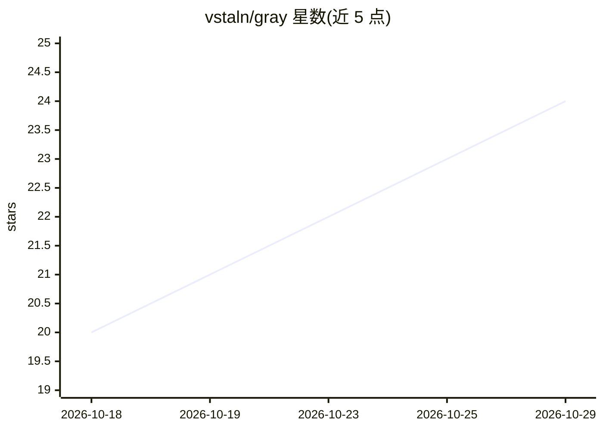

# vstaln/gray

⭐ 24 · Rust · MIT · 推送 2026-10-28 · [GitHub](https://github.com/vstaln/gray) · [官网](https://gray.alignment.id) · 个人维护

**单文件 Rust 编写的常驻 AI agent 运行框架，任意模型可接入**

Gray 是以单个静态 Rust 二进制分发的编码与自动化 agent 框架：用户自带模型与 API key，通过原生 Anthropic Messages API 或任意 OpenAI 兼容 provider（含 Ollama 本地模型）驱动。工具层仅一个 bash 工具，支持后台作业、JSONL 会话与分支恢复、上下文窗口自动压缩、跨会话记忆、SKILL.md 技能与 stdio 插件扩展；通过 cron 与 gateway 用户级服务实现终端关闭后仍持续运行。可读取 AGENTS.md/CLAUDE.md 等既有配置。会话以用户权限直接执行 shell 命令，无审批与沙箱；Windows 上暂不支持 gateway/cron。

## 筛选速览

| 维度 | 判定 | 备注 |
|---|---|---|
| AI 角色 | `ai-native` | 本体是模型或模型工具 |
| 许可风险 | `permissive` | MIT |
| 部署形态 | `library` | 以包/库形式分发 |
| 模型依赖 | local-ok | 支持本地模型 |
| 硬件要求 | — | 无带数字的原话,不猜 |
| 安装摩擦 | `medium` | 含编译或系统依赖之一 |
| 成熟度 | `idea` | |

## 能力要点

- 单个静态二进制，支持 Linux/macOS/Windows，自带自更新
- 原生 Anthropic API 加任意 OpenAI 兼容 provider 与 Ollama 本地模型
- cron 自调度与 gateway 用户服务，终端关闭后任务仍执行
- JSONL 可恢复会话、上下文自动压缩、SKILL.md 技能与 stdio 插件

## 适用场景

- 让 agent 定时执行总结提交、巡检等常驻任务
- 用自有 API key 或本地模型驱动日常编码与自动化
- 复用已有 Claude Code/opencode 的技能文件与配置

## 场景标签

`Agent 框架` `编码 Agent` `工作流自动化` · 领域:Agent 开发

## 证据(README 行号)

> L14: Gray is a coding and automation agent in a single Rust binary. Bring any model — Claude, GPT, Gemini, open models, 
> L26: |**Any model, your keys**|Native Anthropic Messages API for Claude (prompt caching, extended thinking). Every OpenA
> L42: |Models|Any OpenAI-compatible provider, Ollama/local, or a Claude/ChatGPT plan via plugins|Claude plans / Anthropic

## 星数曲线

2026-10-18 20 → 2026-10-29 24（+4）

---
*卡片 v1 · prompt 1.4 · 生成 2026-10-27 · 置信度 high · 依据 README sha `1f17ec3d66e1` · [字段定义](../../DATASET.md)*
