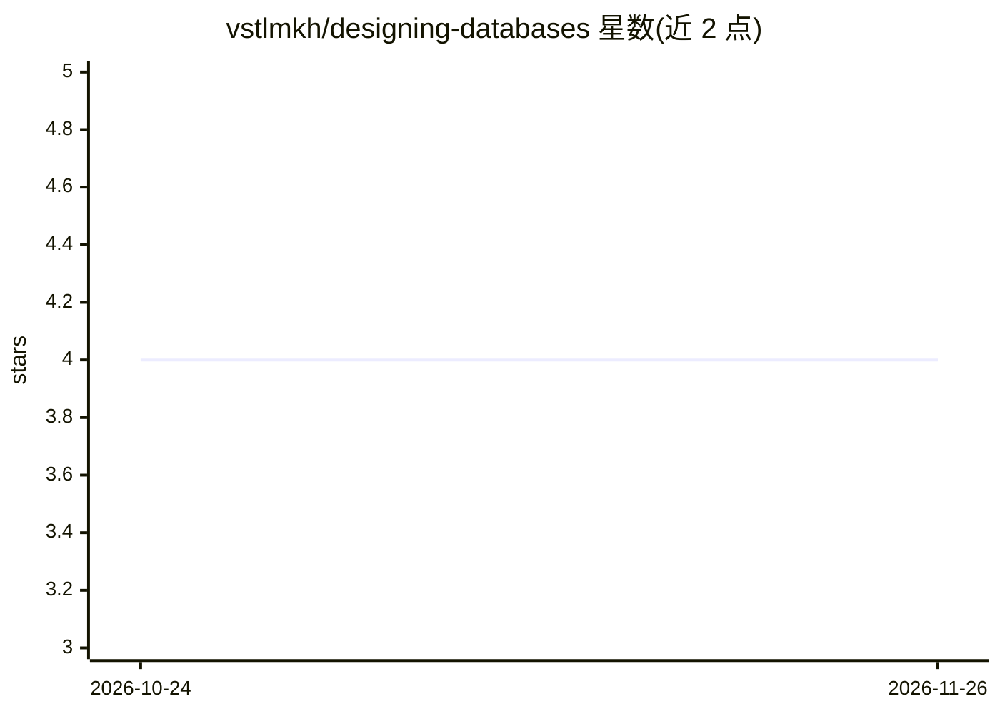

# vstlmkh/designing-databases

⭐ 4 · Python · MIT · 推送 2026-11-23 · [GitHub](https://github.com/vstlmkh/designing-databases) · 个人维护

**数据库设计/调优的 Agent Skill：面向 PostgreSQL 与 MySQL 开发者**

以 Agent Skill 形式打包的关系型数据库设计、审计与调优知识库，覆盖 PostgreSQL 13+ 与 MySQL 8.0+/InnoDB：schema 与主键设计、索引策略（B+tree、GIN/BRIN 等）、EXPLAIN 计划诊断、事务与锁、零停机迁移。通过 npx 安装到 Claude 技能目录，在对话涉及 schema、慢查询或迁移时自动激活；附带的 Python 审计脚本仅用标准库、无网络，退出码可作 CI 门禁。明确声明不覆盖 NoSQL，且不经批准不执行 DDL。

## 筛选速览

| 维度 | 判定 | 备注 |
|---|---|---|
| AI 角色 | `ai-ecosystem` | LLM/agent 周边工具 |
| 许可风险 | `permissive` | MIT |
| 部署形态 | `library` | 以包/库形式分发 |
| 模型依赖 | — | README 未给出锁定关系 |
| 硬件要求 | — | 无带数字的原话,不猜 |
| 安装摩擦 | `low` | 无编译、无系统依赖或容器化 |
| 成熟度 | — | 结构信号不足 |

## 能力要点

- 基于真实 schema/执行计划/统计信息给出建议并指明引擎机制
- 覆盖 12 种迁移工具（Alembic、Flyway、Prisma 等）的引擎特定命令与陷阱
- 标准库 Python 审计脚本，退出码 0/1/2 可用作 CI 门禁
- 对话内容触发自动激活，无需显式指定数据库

## 适用场景

- 设计新表的 schema、主键与索引策略
- 排查慢查询并解读 EXPLAIN (ANALYZE, BUFFERS) 计划
- 规划不锁表的零停机 DDL 迁移
- 在 CI 中对 DDL 做结构化审计

## 场景标签

 · 领域:数据库/开发工具

## 证据(README 行号)

> L12: An Agent Skill for designing, auditing
> L41: npx @vstlmkh/designing-databases install            # ~/.claude/skills/
> L61: Standard-library Python 3. No install, no network. Each exits `0` when clean,

## 星数曲线

2026-10-24 4 → 2026-11-26 4（+0）

---
*卡片 v1 · prompt 1.4 · 生成 2026-11-21 · 置信度 mid · 依据 README sha `ab0decf014d7` · [字段定义](../../DATASET.md)*
