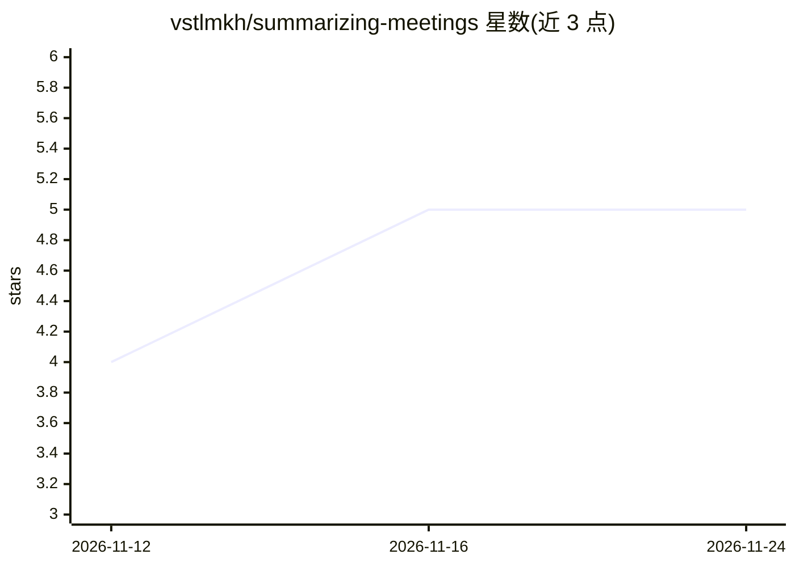

# vstlmkh/summarizing-meetings

⭐ 5 · JavaScript · MIT · 推送 2026-11-23 · [GitHub](https://github.com/vstlmkh/summarizing-meetings) · 个人维护

**把会议原始转写整理成清洁记录与行动项跟进的 Agent 技能**

一个符合 Agent Skills 开放标准的技能包，供 Claude Code 等读取 SKILL.md 格式的 agent 加载，将 Granola 或任意 ASR 输出的会议转写整理为可读记录和基于引文的行为项跟进。工作流分三个阶段（议程收集、转写清洁、跟进生成），每阶段结束后暂停等待操作者确认；所有跟进声明须先在转写中找到引文依据，不可逆操作（写入 tracker、发送跟进）需显式批准。通过 npx 安装或源码软链，附带 evals 场景与校验脚本。

## 筛选速览

| 维度 | 判定 | 备注 |
|---|---|---|
| AI 角色 | `ai-native` | 本体是模型或模型工具 |
| 许可风险 | `permissive` | MIT |
| 部署形态 | `library` | 以包/库形式分发 |
| 模型依赖 | — | README 未给出锁定关系 |
| 硬件要求 | — | 无带数字的原话,不猜 |
| 安装摩擦 | `low` | 无编译、无系统依赖或容器化 |
| 成熟度 | — | 结构信号不足 |

## 能力要点

- 三阶段操作者门控工作流，每阶段末暂停等待确认
- 跟进中的每条声明须有转写引文依据，不确定处列入 uncertainty block
- 遵循 Agent Skills 开放标准，任何读取 SKILL.md 的 agent 可加载
- 应用 Anthropic 提示工程最佳实践（XML 标签、示例包裹、规则附原因）

## 适用场景

- 把 Granola/Zoom/Meet 转写整理成干净的会议记录
- 从会议转写生成带行动项的跟进文档
- 在 Claude Code 之外的自定义 agent 中复用该转写整理流程

## 场景标签

`AI 写作` · 领域:内容生成

## 证据(README 行号)

> L9: An agent skill that turns a meeting transcript — primarily Granola, but any ASR
> L13: Conforms to the Agent Skills open standard.
> L42: 1. **Agenda & intake** — the operator states the agenda, participants, meeting

## 星数曲线

2026-11-12 4 → 2026-11-24 5（+1）

---
*卡片 v1 · prompt 1.4 · 生成 2026-11-21 · 置信度 high · 依据 README sha `78056ada233a` · [字段定义](../../DATASET.md)*
