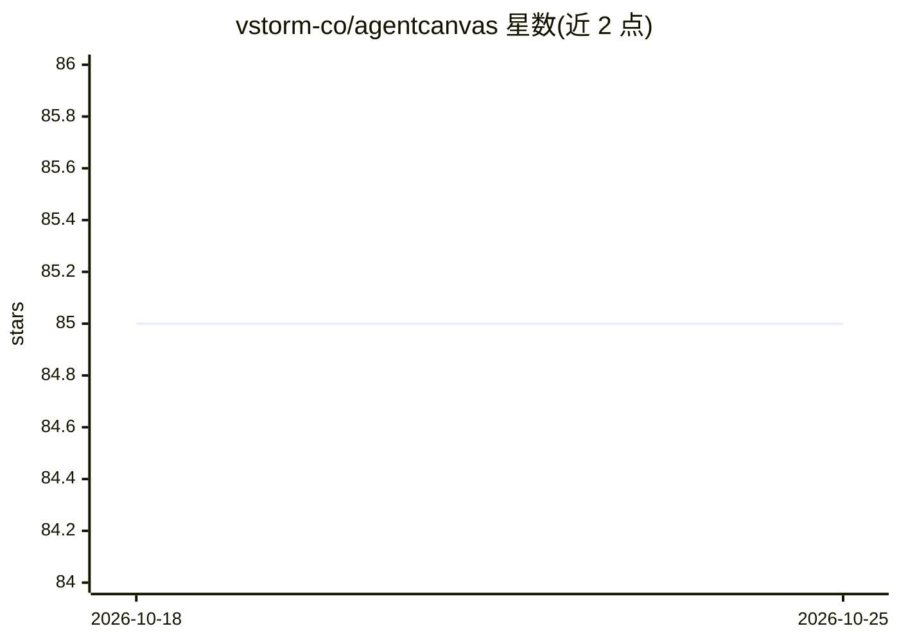

# vstorm-co/agentcanvas

⭐ 85 · Python · MIT · 推送 2026-08-01 · [GitHub](https://github.com/vstorm-co/agentcanvas) · [官网](https://vstorm.co) · 组织维护

**将 Logfire 中的 Pydantic AI agent 运行轨迹渲染为交互式 HTML 图**

读取 Pydantic AI 记录到 Logfire 的 OpenTelemetry GenAI spans，重建为递归工作流结构（轮次→回合→工具→嵌套子 agent），用 genai-prices 计算精确成本，渲染为单文件自包含 HTML 报告：可缩放拖拽的流程图、逐节点 inspector（tokens/成本/推理/可用工具）、完整对话转录与讲解式导览。面向需要向客户或团队展示 agent 工作流的开发者。以 pip 包 + CLI + Python 库形式提供，需设置 LOGFIRE_READ_TOKEN。

## 筛选速览

| 维度 | 判定 | 备注 |
|---|---|---|
| AI 角色 | `ai-ecosystem` | LLM/agent 周边工具 |
| 许可风险 | `permissive` | MIT |
| 部署形态 | `library` | 以包/库形式分发 |
| 模型依赖 | — | README 未给出锁定关系 |
| 硬件要求 | — | 无带数字的原话,不猜 |
| 安装摩擦 | `medium` | 含编译或系统依赖之一 |
| 成熟度 | — | 结构信号不足 |

## 能力要点

- 从 Logfire Query API 读取 span 树重建递归工作流
- 逐模型调用与全程的 token 统计与基于 genai-prices 的精确成本
- 嵌套子 agent 递归绘制，深度不限
- 输出单文件离线 HTML，含引导式导览模式

## 适用场景

- 在客户会议中演示 agent 每一步做了什么、花了多少钱
- 调试和审查多轮对话、工具调用与嵌套子 agent 的执行过程
- 把某次 agent 运行的完整流程打包发给他人离线查看

## 场景标签

`LLM 可观测性` · 领域:评测与运维

## 证据(README 行号)

> L114: Logfire (OpenTelemetry GenAI spans)  ──query──►  parser  ──►  payload  ──render──►  agent_flow.html
> L118: `execute_tool`). agentcanvas reads them through the Logfire **Query API** (SQL + a read token),

## 星数曲线

2026-10-18 85 → 2026-10-25 85（+0）

---
*卡片 v1 · prompt 1.4 · 生成 2026-10-24 · 置信度 high · 依据 README sha `e964efbc81e2` · [字段定义](../../DATASET.md)*
