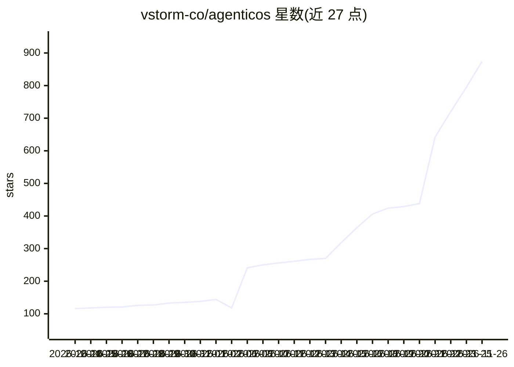

# vstorm-co/agenticos

⭐ 874 · Python · Apache-2.0 · 推送 2026-11-25 · [GitHub](https://github.com/vstorm-co/agenticos) · [官网](https://vstorm-co.github.io/vstormos-landing/) · 组织维护

**企业自托管 AI agent 平台：构建、共享并治理公司内部 AI 队友**

基于 Pydantic AI 的自托管 agent 平台（Apache-2.0），供公司团队在自有服务器与模型上构建、运行和管理 agent。功能含共享聊天、RAG、技能、内置浏览器、4,700+ MCP 服务器接入、预算控制、审批与审计日志；支持将 agent 发布到 Slack、Teams、Discord、Telegram、网站挂件或 API。技术栈为 FastAPI、PostgreSQL（pgvector）与 Next.js，通过 Docker Compose 部署，支持 28 家模型供应商及本地模型。管理机制包括按 agent 的使用权限、花费上限与需人工审批的操作。

## 筛选速览

| 维度 | 判定 | 备注 |
|---|---|---|
| AI 角色 | `ai-ecosystem` | LLM/agent 周边工具 |
| 许可风险 | `permissive` | Apache-2.0 |
| 部署形态 | `self-host` | docker 或自建部署 |
| 模型依赖 | local-ok | 支持本地模型 |
| 硬件要求 | — | 无带数字的原话,不猜 |
| 安装摩擦 | `low` | 无编译、无系统依赖或容器化 |
| 成熟度 | — | 结构信号不足 |

## 能力要点

- 浏览器内构建并发布 agent，支持 Slack/Teams/Discord/Telegram/网站挂件/API 等渠道
- 4,700+ MCP 服务器接入，可按 agent 配置可用工具
- 预算、审批与审计日志的治理机制
- 兼容 28 家模型供应商，含 Ollama 与 vLLM 本地模型

## 适用场景

- 给公司搭一套自有的内部 AI agent 层，数据留在自己服务器
- 让团队和 agent 在同一个共享聊天里协作处理文档与工具任务
- IT/安全团队对 agent 使用做预算、审批与审计管理
- 把研究类长任务交给 agent 后台执行，结果回写对话

## 场景标签

`AI 助手` `浏览器自动化` `RAG` · 领域:效率与自动化

## 证据(README 行号)

> L172: **AgenticOS is an open-source (Apache-2.0), self-hosted layer for building, sharing and governing AI agents across
> L176: It runs on your own infrastructure with Docker Compose and works with 28 model providers, including your ChatGPT s

## 星数曲线

2026-10-24 116 → 2026-11-26 874（+758）

---
*卡片 v1 · prompt 1.4 · 生成 2026-11-24 · 置信度 high · 依据 README sha `2a1e5f221882` · [字段定义](../../DATASET.md)*
