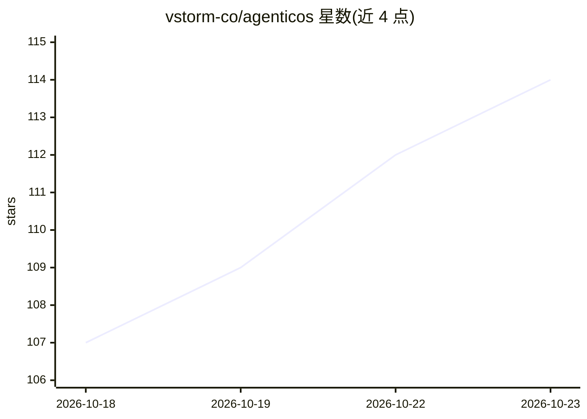

# vstorm-co/agenticos

⭐ 114 · Python · Apache-2.0 · 推送 2026-10-22 · [GitHub](https://github.com/vstorm-co/agenticos) · [官网](https://vstorm-co.github.io/agenticos/) · 组织维护

**自托管的企业 AI agent 层：构建、运行并治理 AI 队友**

Apache-2.0 开源、自托管的 agent 平台，由 Vstorm 维护：团队在浏览器中配置 agent（指令、模型、工具），发布到 Web 聊天、Slack、Mattermost、Telegram、网站挂件或 API；内置真实浏览器、RAG、技能系统与 4,700+ MCP 服务器画廊。管理员控制角色权限、预算、人工审批，每次运行有审计记录。底层为 Pydantic AI、FastAPI、PostgreSQL+pgvector、Next.js，Docker Compose 部署，支持 28 个模型提供方（含 Ollama/vLLM 本地模型与 ChatGPT 订阅）。限制：需自行运维基础设施，最低 4 vCPU / 8 GB RAM。

## 筛选速览

| 维度 | 判定 | 备注 |
|---|---|---|
| AI 角色 | `ai-ecosystem` | LLM/agent 周边工具 |
| 许可风险 | `permissive` | Apache-2.0 |
| 部署形态 | `self-host` | docker 或自建部署 |
| 模型依赖 | local-ok | 支持本地模型 |
| 硬件要求 | — | 无带数字的原话,不猜 |
| 安装摩擦 | `low` | 无编译、无系统依赖或容器化 |
| 成熟度 | — | 结构信号不足 |

## 能力要点

- 浏览器内构建 agent 并发布到 8 种应答渠道（Slack/Telegram/API 等）
- 4,700+ MCP 服务器画廊与 29 项内置能力，按 agent 授权工具调用
- 预算、审批、角色与审计记录的治理层
- 支持 28 个模型提供方，含 Ollama/vLLM 本地模型与 ChatGPT/Claude 订阅

## 适用场景

- 企业内部部署自有 AI agent 层，替代厂商云端的按席助手
- 团队把重复的文档处理、报告生成、合同检查等工作交给 agent
- IT/安全团队对 AI agent 施加数据主权、预算与审批管控

## 场景标签

 · 领域:企业 AI 基础设施/Agent 平台

## 证据(README 行号)

> L118: **AgenticOS is an open-source (Apache-2.0), self-hosted layer for building, sharing and governing AI agents across
> L122: It runs on your own infrastructure with Docker Compose and works with 28 model providers, including your ChatGPT s

## 星数曲线

2026-10-18 107 → 2026-10-23 114（+7）

---
*卡片 v1 · prompt 1.4 · 生成 2026-10-23 · 置信度 high · 依据 README sha `3c58710134fa` · [字段定义](../../DATASET.md)*
