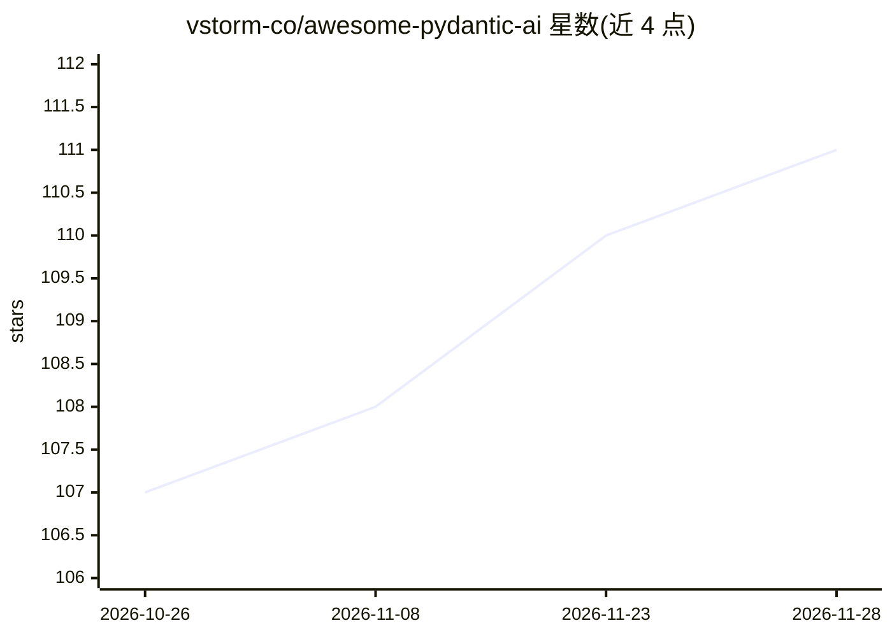

# vstorm-co/awesome-pydantic-ai

⭐ 111 · NOASSERTION · 推送 2026-11-08 · [GitHub](https://github.com/vstorm-co/awesome-pydantic-ai) · [官网](https://vstorm-co.github.io/awesome-pydantic-ai/) · 组织维护

**Pydantic AI 框架的资源策展清单：查找配套库与教程**

围绕 Pydantic AI（Python agent 框架）整理的 awesome 清单，按官方资源、框架与库、模板、示例教程、可观测性、文章与案例研究分类收录条目。覆盖 agent 编排、guardrails、记忆、沙箱、工具授权、LLM-judge、观测追踪等方向的第三方库，以及交互式笔记本、课程与博客。以链接列表形式维护，采用 CC BY 4.0 许可。

## 筛选速览

| 维度 | 判定 | 备注 |
|---|---|---|
| AI 角色 | `ai-knowledge` | 知识聚合/清单类 |
| 许可风险 | `none` | NOASSERTION |
| 部署形态 | `self-host` | docker 或自建部署 |
| 模型依赖 | — | README 未给出锁定关系 |
| 硬件要求 | — | 无带数字的原话,不猜 |
| 安装摩擦 | `low` | 无编译、无系统依赖或容器化 |
| 成熟度 | — | 结构信号不足 |

## 能力要点

- 收录 20+ 个基于 Pydantic AI 的框架与库条目
- 分类覆盖编排、guardrails、记忆、沙箱、观测等方向
- 包含教程、课程与交互式笔记本资源

## 适用场景

- 为 Pydantic AI 项目查找多智能体编排或记忆管理库
- 学习 Pydantic AI 的类型安全 agent 开发教程
- 为 Pydantic AI agent 选择可观测性平台

## 场景标签

`精选清单` `教程课程` · 领域:学习与行业

## 证据(README 行号)

> L3: > An opinionated list of awesome Pydantic AI frameworks, libraries, software and resources.
> L7: ## Contents

## 星数曲线

2026-10-26 107 → 2026-11-28 111（+4）

---
*卡片 v1 · prompt 1.4 · 生成 2026-11-28 · 置信度 mid · 依据 README sha `b2ab92c677d4` · [字段定义](../../DATASET.md)*
