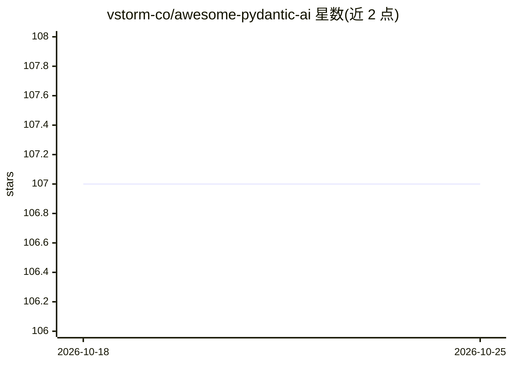

# vstorm-co/awesome-pydantic-ai

⭐ 107 · NOASSERTION · 推送 2026-10-21 · [GitHub](https://github.com/vstorm-co/awesome-pydantic-ai) · [官网](https://vstorm-co.github.io/awesome-pydantic-ai/) · 组织维护

**Pydantic AI 生态资源策展清单：框架、库、教程与案例**

围绕 Python agent 框架 Pydantic AI 的 awesome 清单，收录官方资源、第三方框架与库（如 pai-agent-sdk、pydantic-deep、pydantic-ai-shields、pydantic-collab 等）、项目模板、示例教程、可观测性工具（Logfire、OrcaReplay）、文章与案例研究。条目按类别组织，每条附一句功能描述。面向使用 Pydantic AI 构建生产级生成式 AI 应用的开发者，用于发现扩展库与学习资源。内容采用 CC BY 4.0 许可。

## 筛选速览

| 维度 | 判定 | 备注 |
|---|---|---|
| AI 角色 | `ai-knowledge` | 知识聚合/清单类 |
| 许可风险 | `none` | NOASSERTION |
| 部署形态 | `self-host` | docker 或自建部署 |
| 模型依赖 | — | README 未给出锁定关系 |
| 硬件要求 | — | 无带数字的原话,不猜 |
| 安装摩擦 | `low` | 无编译、无系统依赖或容器化 |
| 成熟度 | — | 结构信号不足 |

## 能力要点

- 收录 20+ 个 Pydantic AI 扩展框架与库（编排、护栏、记忆、沙箱、审计等）
- 包含官方文档/仓库与 Logfire 可观测性工具条目
- 提供示例教程与文章条目（含 Ollama 本地模型示例、RealPython 教程）

## 适用场景

- 为 Pydantic AI 项目寻找多智能体编排、护栏或沙箱等扩展库
- 学习 Pydantic AI 的类型安全 agent 开发模式
- 了解 Pydantic AI 生态中的模板与可观测性方案

## 场景标签

`精选清单` · 领域:学习与行业

## 证据(README 行号)

> L3: > An opinionated list of awesome Pydantic AI frameworks, libraries, software and resources.
> L5: Pydantic AI is a Python agent framework designed to make it easier to build production-grade applications with Gener

## 星数曲线

2026-10-18 107 → 2026-10-25 107（+0）

---
*卡片 v1 · prompt 1.4 · 生成 2026-10-23 · 置信度 mid · 依据 README sha `d29bf06f3d2b` · [字段定义](../../DATASET.md)*
