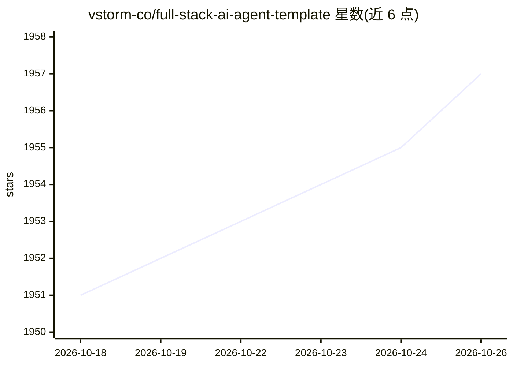

# vstorm-co/full-stack-ai-agent-template

⭐ 1,957 · Python · MIT · 推送 2026-10-25 · [GitHub](https://github.com/vstorm-co/full-stack-ai-agent-template) · [官网](https://vstorm-co.github.io/full-stack-ai-agent-template/) · 组织维护

**生成 FastAPI+Next.js 全栈 AI Agent 应用的项目模板生成器**

由 Vstorm 团队维护的 CLI 项目生成器（pip 包 fastapi-fullstack），通过交互式向导脚手架生产级 FastAPI + Next.js 15 全栈应用，内置 5 种 AI Agent 框架选项（Pydantic AI、Pydantic Deep Agents、LangChain、LangGraph、DeepAgents）、支持 Milvus/Qdrant/pgvector/ChromaDB 的 RAG 管线、WebSocket 流式聊天 UI，以及 JWT/OAuth 认证、管理面板、Celery、Stripe 计费、Docker/K8s 等 20+ 企业集成。提供 make bootstrap 一键启动开发栈、3-way merge 模板升级机制和多环境 Compose 配置。需 Python 3.11+。

## 筛选速览

| 维度 | 判定 | 备注 |
|---|---|---|
| AI 角色 | `ai-ecosystem` | LLM/agent 周边工具 |
| 许可风险 | `permissive` | MIT |
| 部署形态 | `library` | 以包/库形式分发 |
| 模型依赖 | — | README 未给出锁定关系 |
| 硬件要求 | — | 无带数字的原话,不猜 |
| 安装摩擦 | `medium` | 含编译或系统依赖之一 |
| 成熟度 | — | 结构信号不足 |

## 能力要点

- 5 种 AI Agent 框架可选（Pydantic AI/LangChain/LangGraph 等）
- RAG 管线支持 Milvus、Qdrant、pgvector、ChromaDB
- 内置认证、管理面板、Stripe 计费、团队工作区等生产功能
- make upgrade 三方合并升级，保留用户自定义

## 适用场景

- 快速搭建带 AI Agent 与 RAG 的生产级全栈应用
- 团队需要带认证、计费、管理面板的 AI SaaS 起点
- 选择不同 Agent 框架生成对应技术栈的项目

## 场景标签

`代码生成` · 领域:编码与开发

## 证据(README 行号)

> L9:  Production-ready FastAPI + Next.js project generator with AI agents, RAG, and 20+ enterprise integrations.
> L31:  🤖 5 AI Agent Frameworks (Pydantic AI, Pydantic Deep Agents, LangChain, LangGraph, DeepAgents)

## 星数曲线

2026-10-18 1,951 → 2026-10-26 1,957（+6）

---
*卡片 v1 · prompt 1.4 · 生成 2026-10-21 · 置信度 mid · 依据 README sha `979049b5a279` · [字段定义](../../DATASET.md)*
