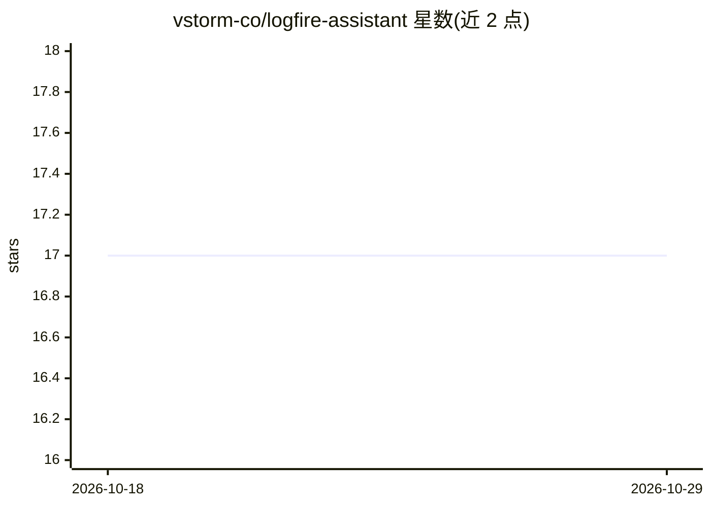

# vstorm-co/logfire-assistant

⭐ 17 · Python · MIT · 推送 2026-02-09 · [GitHub](https://github.com/vstorm-co/logfire-assistant) · [官网](https://logfire-us.pydantic.dev/) · 组织维护

**面向 Pydantic Logfire 的 AI 调试助手：自然语言查询生成 SQL 与图表**

Vstorm 开发的开源 AI 调试分析工具：以 Chrome 扩展形式嵌入 Logfire 仪表盘，用户用自然语言提问，后端由 PydanticAI 驱动的 agent 将问题转为针对 Logfire 数据的 SQL 查询，并自动生成可视化图表；支持在 Logfire UI 中选定 span 追问、多项目切换、自定义提示模板、多 LLM 模型选择、WebSocket 流式响应与 JWT 认证。后端基于 FastAPI/PostgreSQL/Redis，浏览器扩展用 Bun 构建，面向使用 Logfire 做可观测性的开发团队。

## 筛选速览

| 维度 | 判定 | 备注 |
|---|---|---|
| AI 角色 | `ai-native` | 本体是模型或模型工具 |
| 许可风险 | `permissive` | MIT |
| 部署形态 | `None` |  |
| 模型依赖 | — | README 未给出锁定关系 |
| 硬件要求 | — | 无带数字的原话,不猜 |
| 安装摩擦 | `medium` | 含编译或系统依赖之一 |
| 成熟度 | — | 结构信号不足 |

## 能力要点

- 自然语言提问自动生成 SQL 查询 Logfire 数据
- 查询结果自动生成图表可视化
- 在 Logfire UI 中选定 span 直接追问上下文
- 支持多 LLM 模型选择与自定义提示模板

## 适用场景

- 调试 AI agent 应用时用自然语言查询长链路 trace
- 把问题转成 SQL 分析 Logfire 中的 span 与请求数据
- 为常见分析任务沉淀可复用的提示模板

## 场景标签

`LLM 可观测性` `数据分析` · 领域:效率与自动化

## 证据(README 行号)

> L29: **Logfire AI Assistant by Vstorm** is an AI-powered tool that helps you debug, analyze, and understand your applica
> L92: |**🗃️ SQL Query Generation**|AI translates questions into SQL against Logfire data|

## 星数曲线

2026-10-18 17 → 2026-10-29 17（+0）

---
*卡片 v1 · prompt 1.4 · 生成 2026-10-29 · 置信度 high · 依据 README sha `4478d3c19b42` · [字段定义](../../DATASET.md)*
