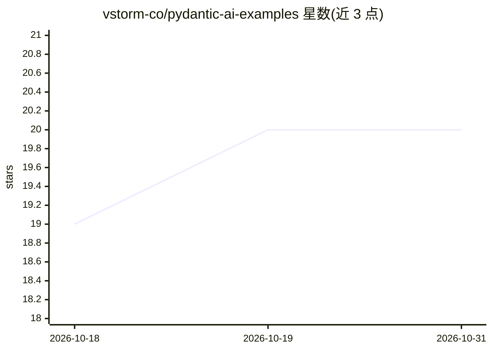

# vstorm-co/pydantic-ai-examples

⭐ 20 · Python · MIT · 推送 2026-09-29 · [GitHub](https://github.com/vstorm-co/pydantic-ai-examples) · [官网](https://vstorm-co.github.io/pydantic-ai-examples/) · 组织维护

**社区维护的 PydanticAI 框架示例集合（8 个渐进式示例）**

由 vstorm 团队维护的 PydanticAI 示例库，按推荐学习路径组织 8 个示例：直接模型请求、温度参数、推理力度、固定三分类情感分析、运行时动态分类（create_model 生成 schema）、经 Ollama 本地运行波兰语模型 Bielik、多轮对话历史管理（JSON/数据库持久化、上下文窗口策略）、带 schema 校验的 OCR 文档解析。多数示例使用 OpenAI GPT-5.1，需 OPENAI_API_KEY，要求 Python 3.13+ 与 uv，OCR 示例另需系统安装 poppler。

## 筛选速览

| 维度 | 判定 | 备注 |
|---|---|---|
| AI 角色 | `ai-knowledge` | 知识聚合/清单类 |
| 许可风险 | `permissive` | MIT |
| 部署形态 | `None` |  |
| 模型依赖 | local-ok | 支持本地模型 |
| 硬件要求 | — | 无带数字的原话,不猜 |
| 安装摩擦 | `low` | 无编译、无系统依赖或容器化 |
| 成熟度 | — | 结构信号不足 |

## 能力要点

- 8 个渐进式示例覆盖从基础 API 调用到 OCR 文档处理
- 结构化输出示例：Literal 固定分类与 create_model 运行时动态 schema
- Bielik 示例演示经 Ollama 本地运行模型与工具调用
- 历史管理示例含 JSON/数据库持久化与 token 感知上下文窗口

## 适用场景

- 按学习路径入门 PydanticAI 框架的 Agent 与结构化输出
- 参考动态分类与 OCR 解析的实现模式
- 了解如何在 Ollama 上本地运行模型接入 Agent

## 场景标签

`教程课程` · 领域:学习与行业

## 证据(README 行号)

> L3: A comprehensive collection of examples demonstrating PydanticAI framework capabilities, from basic model requests to
> L26: **Recommended order for learning PydanticAI**:

## 星数曲线

2026-10-18 19 → 2026-10-31 20（+1）

---
*卡片 v1 · prompt 1.4 · 生成 2026-10-28 · 置信度 high · 依据 README sha `95c603847dcb` · [字段定义](../../DATASET.md)*
