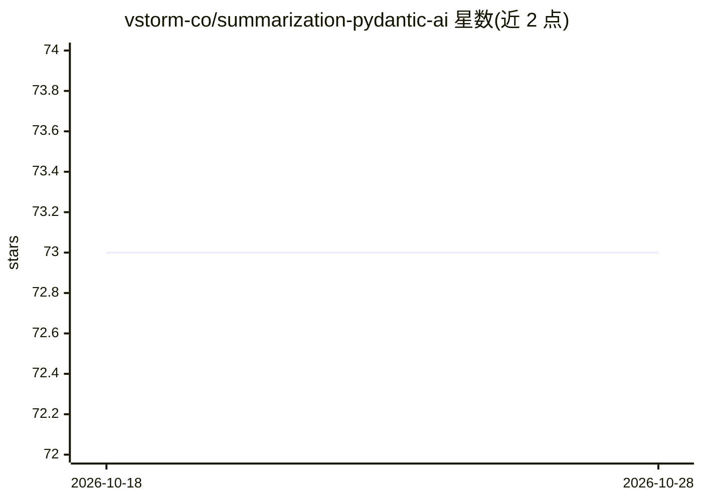

# vstorm-co/summarization-pydantic-ai

⭐ 73 · Python · MIT · 推送 2026-10-28 · [GitHub](https://github.com/vstorm-co/summarization-pydantic-ai) · [官网](https://vstorm-co.github.io/summarization-pydantic-ai/) · 组织维护

**Pydantic AI 代理的上下文管理库：自动摘要或滑窗防溢出**

面向 Pydantic AI 开发者的 Python 库，处理长对话与长运行代理的上下文溢出：提供 LLM 智能摘要、零成本滑动窗口、限额警告三类处理器，支持按消息数/token 数/上下文比例触发与保留，压缩时保持工具调用/响应对完整，自动检测模型上下文窗口并截断大型工具输出，可自定义摘要 prompt 与模型。注意：核心功能已并入官方 pydantic-ai-harness，README 建议新项目改用 harness，本库继续在 PyPI 维护存量用户。由 Vstorm 公司维护。

## 筛选速览

| 维度 | 判定 | 备注 |
|---|---|---|
| AI 角色 | `ai-ecosystem` | LLM/agent 周边工具 |
| 许可风险 | `permissive` | MIT |
| 部署形态 | `library` | 以包/库形式分发 |
| 模型依赖 | — | README 未给出锁定关系 |
| 硬件要求 | — | 无带数字的原话,不猜 |
| 安装摩擦 | `low` | 无编译、无系统依赖或容器化 |
| 成熟度 | — | 结构信号不足 |

## 能力要点

- LLM 摘要与零成本滑动窗口两种压缩策略
- 压缩时安全保留 tool call/response 配对
- 按 messages/tokens/fraction 灵活触发与保留
- 代理可调用 compact_conversation 工具按需压缩

## 适用场景

- 长运行 agent 自动压缩历史避免上下文溢出
- 客服机器人保留关键信息丢弃例行对话
- 高频应用用滑动窗口实现零成本上下文裁剪

## 场景标签

`Agent 记忆` · 领域:Agent 开发

## 证据(README 行号)

> L62: **Summarization for Pydantic AI** keeps your Pydantic AI agents running through long conversations without ever exc
> L94: The recommended way to add context management is via pydantic-ai's native Capabilities API:

## 星数曲线

2026-10-18 73 → 2026-10-28 73（+0）

---
*卡片 v1 · prompt 1.4 · 生成 2026-10-24 · 置信度 high · 依据 README sha `065403973e50` · [字段定义](../../DATASET.md)*
