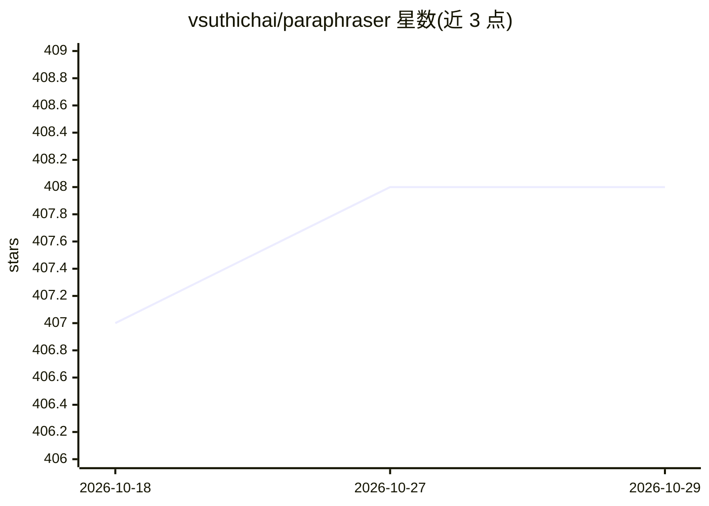

# vsuthichai/paraphraser

⭐ 408 · Python · MIT · 推送 2026-07-09 · [GitHub](https://github.com/vsuthichai/paraphraser) · [官网](http://pair-a-phrase.it) · 个人维护

**句子级改写生成器：双向 LSTM 序列到序列模型**

提供句子改写（paraphrase）生成的项目，基于 TensorFlow 实现的双向 LSTM 编码器与 LSTM 解码器加注意力机制，训练数据聚合 para-nmt-5m、Quora 问题对、SNLI 等公开数据集，预训练词向量来自 para-nmt-50m 项目。面向开发者与科研人员，通过 inference.py 脚本加载下载的模型 checkpoint 进行推理，需 Python 3.5、TensorFlow 1.4.1 与 spacy 环境conda 创建。训练在 Nvidia GTX 1080 上进行，聚合数据集未包含在仓库中。pip 可安装包列为 TODO 未实现。

## 筛选速览

| 维度 | 判定 | 备注 |
|---|---|---|
| AI 角色 | `ai-native` | 本体是模型或模型工具 |
| 许可风险 | `permissive` | MIT |
| 部署形态 | `library` | 以包/库形式分发 |
| 模型依赖 | — | README 未给出锁定关系 |
| 硬件要求 | — | 无带数字的原话,不猜 |
| 安装摩擦 | `low` | 无编译、无系统依赖或容器化 |
| 成熟度 | — | 结构信号不足 |

## 能力要点

- 双向 LSTM 编码器 + LSTM 解码器带注意力的改写生成模型
- 提供模型 checkpoint 下载与 inference.py 推理脚本
- 训练数据聚合 para-nmt-5m、Quora、SNLI 等公开数据集

## 适用场景

- 为句子生成改写变体用于数据增强
- 研究序列到序列改写生成模型的实现
- 基于预训练 checkpoint 快速体验句子改写

## 场景标签

`AI 写作` · 领域:内容生成

## 证据(README 行号)

> L3: This project provides users the ability to do paraphrase generation for sentences through a clean and simple API. A 
> L9: The underlying model is a bidirectional LSTM encoder and LSTM decoder with attention trained using Tensorflow. Downl

## 星数曲线

2026-10-18 407 → 2026-10-29 408（+1）

---
*卡片 v1 · prompt 1.4 · 生成 2026-10-22 · 置信度 mid · 依据 README sha `016d286f8d45` · [字段定义](../../DATASET.md)*
