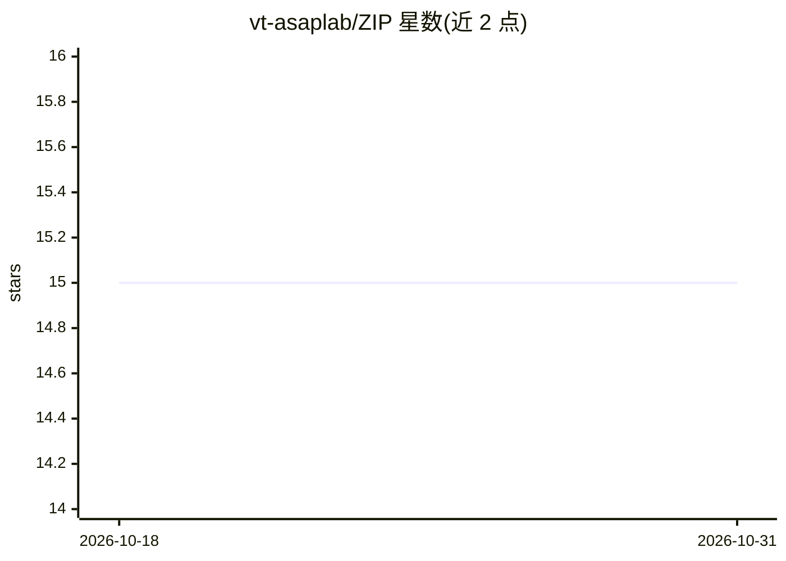

# vt-asaplab/ZIP

⭐ 15 · C · Apache-2.0 · 推送 2026-01-22 · [GitHub](https://github.com/vt-asaplab/ZIP) · 组织维护

**面向 AI 推理的高精度零知识证明研究实现（CCS 2025）**

ZIP 论文（ACM CCS 2025）的官方实现：针对 AI 推理过程生成高精度零知识证明，基于 PLONK 证明系统，使用分段多项式近似处理非线性函数，涉及 IEEE-754 浮点精度与 Caulk 查找表技术。以 Python/Rust/Go 混合脚本仓库形式提供，需 conda 环境与 Git LFS（SRS 文件约 800 MB）才能克隆运行。代码为研究原型，作者声明不适用于生产环境；复现论文实验需大内存（最高约 300 GB）的参考机器。

## 筛选速览

| 维度 | 判定 | 备注 |
|---|---|---|
| AI 角色 | `ai-ecosystem` | LLM/agent 周边工具 |
| 许可风险 | `permissive` | Apache-2.0 |
| 部署形态 | `library` | 以包/库形式分发 |
| 模型依赖 | — | README 未给出锁定关系 |
| 硬件要求 | — | 无带数字的原话,不猜 |
| 安装摩擦 | `low` | 无编译、无系统依赖或容器化 |
| 成熟度 | `idea` | |

## 能力要点

- 对 AI 推理生成高精度零知识证明（PLONK + Caulk）
- 分段多项式近似处理非线性函数
- 提供脚本逐条复现论文图表（Figure 1、Table 1-7）
- 作者声明为研究原型，不适用于生产环境

## 适用场景

- 复现 ZIP 论文的实验数据与图表
- 研究零知识证明在 AI 推理验证中的应用
- 基于该实现开展可验证推理方向的后续研究

## 场景标签

 · 领域:密码学/可验证 AI 推理

## 证据(README 行号)

> L1: # Zero-Knowledge AI Inference with High Precision
> L3: This repository contains the full implementation of **ZIP** paper (accepted to **ACM CCS 2025**).

## 星数曲线

2026-10-18 15 → 2026-10-31 15（+0）

---
*卡片 v1 · prompt 1.4 · 生成 2026-10-30 · 置信度 mid · 依据 README sha `7d5d5c0b8777` · [字段定义](../../DATASET.md)*
