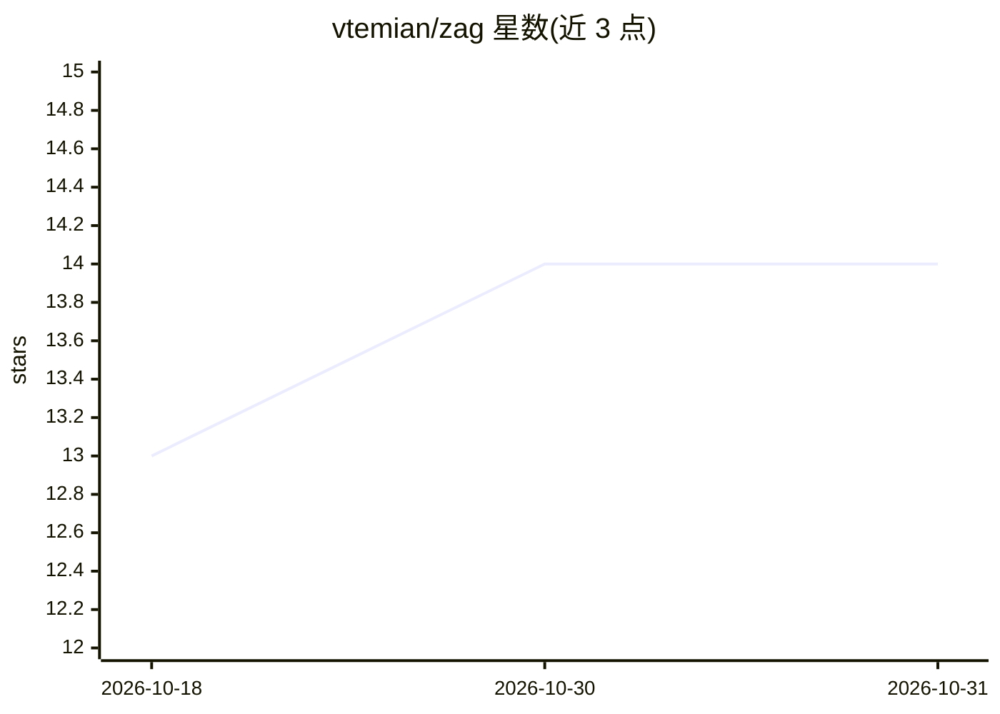

# vtemian/zag

⭐ 14 · Zig · MIT · 推送 2026-07-01 · [GitHub](https://github.com/vtemian/zag) · 个人维护

**Zig 编写的可组合 AI 编码代理，窗口系统即平台**

以 Zig 构建的模态 TUI AI 编码代理：将分屏、焦点、缓冲区作为原语，会话树、响应渲染、系统提示词等均以插件实现。支持 Anthropic Messages、OpenAI Chat Completions/Responses 三种线格式，接入 Anthropic、OpenAI、OpenRouter、Groq、Moonshot、Ollama 等 8 个提供商及 OAuth 登录；提供 Lua 插件运行时、子代理委派、MCP 客户端、沙箱与 headless 评测模式。从源码 zig build 构建，无 Python/npm 依赖。

## 筛选速览

| 维度 | 判定 | 备注 |
|---|---|---|
| AI 角色 | `ai-native` | 本体是模型或模型工具 |
| 许可风险 | `permissive` | MIT |
| 部署形态 | `library` | 以包/库形式分发 |
| 模型依赖 | local-ok | 支持本地模型 |
| 硬件要求 | — | 无带数字的原话,不猜 |
| 安装摩擦 | `low` | 无编译、无系统依赖或容器化 |
| 成熟度 | — | 结构信号不足 |

## 能力要点

- Neovim 式模态 TUI，二叉树分屏与 vim 键位焦点
- 8 个提供商、3 种线格式，会话内 /model 实时切换
- Lua 插件 + 异步 worker 池：自定义工具、钩子、键位、提供商
- task/workflow 子代理委派与结构化输出（JSON schema 校验）

## 适用场景

- 在终端中以分屏工作区同时运行多个模型代理
- 通过 Lua 编写自定义工具与工作流编排子代理
- 接入 MCP 服务器扩展代理可用工具
- 用 headless 模式接入基准评测框架

## 场景标签

`编码 Agent` · 领域:编码与开发

## 证据(README 行号)

> L5: Zag is an AI coding agent where the **window system is the platform**. Splits, focus, and buffers are primitives. Ev
> L25: |**Per-pane streaming agents**|Every pane runs its own agent thread. Different panes, different models, same sessio

## 星数曲线

2026-10-18 13 → 2026-10-31 14（+1）

---
*卡片 v1 · prompt 1.4 · 生成 2026-10-31 · 置信度 mid · 依据 README sha `7478e5e01877` · [字段定义](../../DATASET.md)*
