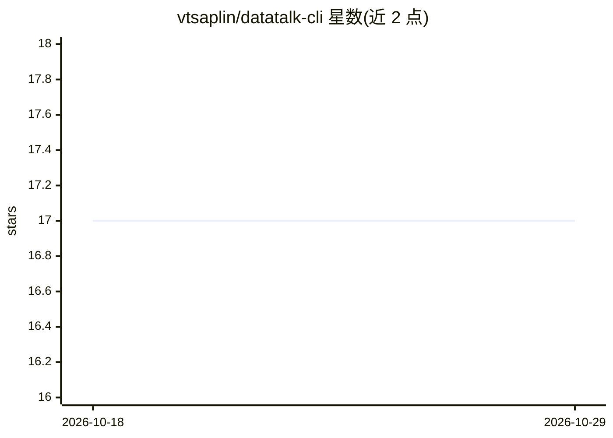

# vtsaplin/datatalk-cli

⭐ 17 · Python · MIT · 推送 2026-09-19 · [GitHub](https://github.com/vtsaplin/datatalk-cli) · 个人维护

**用自然语言查询本地 CSV/Excel/Parquet 的命令行工具**

基于终端的本地数据查询工具：用户以英文自然语言提问，LLM 生成 SQL，由本地 DuckDB 执行，返回查询结果与默认展示的 SQL；支持 CSV、Excel(.xlsx/.xls)、Parquet，交互与单次查询两种模式，并提供 JSON/CSV 结构化输出供脚本管道使用。云端模型仅上传表结构、数据留在本机，配合本地 Ollama 可完全离线运行。面向需要快速查数据而不写 SQL 的开发者和数据使用者，以 pip 安装，需 Python 3.9+ 和一个 LLM API key 或本地 Ollama。

## 筛选速览

| 维度 | 判定 | 备注 |
|---|---|---|
| AI 角色 | `ai-native` | 本体是模型或模型工具 |
| 许可风险 | `permissive` | MIT |
| 部署形态 | `library` | 以包/库形式分发 |
| 模型依赖 | local-ok | 支持本地模型 |
| 硬件要求 | — | 无带数字的原话,不猜 |
| 安装摩擦 | `low` | 无编译、无系统依赖或容器化 |
| 成熟度 | — | 结构信号不足 |

## 能力要点

- 自然语言转 SQL，DuckDB 本地执行，SQL 默认透明展示
- 支持 CSV/Excel/Parquet 多格式与 GB 级文件
- 通过 LiteLLM 接入 100+ 模型（OpenAI/Anthropic/Gemini/Ollama 等）
- JSON/CSV 输出与标准退出码，可嵌入脚本与自动化管道

## 适用场景

- 不写 SQL 直接对 CSV 文件提问拿结果
- 在终端快速核查 Excel/Parquet 数据而不打开表格软件
- 隐私敏感数据在本地（含 Ollama 离线）完成查询
- 把自然语言查询嵌入 shell 脚本做自动化数据处理

## 场景标签

`数据分析` · 领域:效率与自动化

## 证据(README 行号)

> L42: - **100% Local Processing** - Data never leaves your machine, only schema is sent to LLM
> L43: - **100% Offline Option** - Use local Ollama models for complete offline operation, no internet required
> L70: DataTalk uses LiteLLM to support 100+ models from various providers through a unified interface.

## 星数曲线

2026-10-18 17 → 2026-10-29 17（+0）

---
*卡片 v1 · prompt 1.4 · 生成 2026-10-29 · 置信度 high · 依据 README sha `3feef5403a1b` · [字段定义](../../DATASET.md)*
