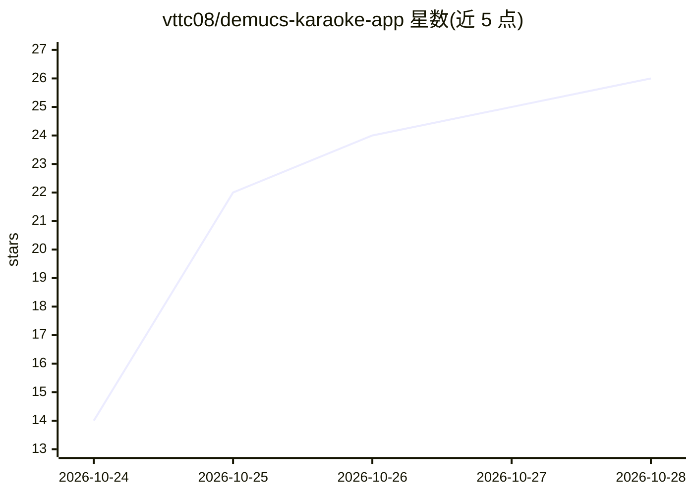

# vttc08/demucs-karaoke-app

⭐ 30 · Python · 推送 2026-10-28 · [GitHub](https://github.com/vttc08/demucs-karaoke-app) · [官网](https://vttc08.github.io/demucs-karaoke-app) · 个人维护 · 中文 README

**本地运行的家庭卡拉 OK 网页应用：AI 分离人声并生成逐字歌词**

面向家庭卡拉 OK 场景的自托管网页应用：通过 Demucs 分离歌曲人声、WhisperX 生成逐字歌词时间轴，支持搜索/下载 YouTube 视频、用户点歌队列、舞台显示自定义、媒体编辑器与自带歌曲上传。ML 依赖被解耦为可选的 Demucs 服务，主应用可经 Docker Compose 部署在 Linux 家用服务器，Demucs 服务支持 CUDA 或纯 CPU 运行，需 Python 3.10 与 Hugging Face token（pyannote 模型）。iOS 设备不支持多轨音频同时播放。界面支持中英等多语言。

## 筛选速览

| 维度 | 判定 | 备注 |
|---|---|---|
| AI 角色 | `ai-native` | 本体是模型或模型工具 |
| 许可风险 | `none` | — |
| 部署形态 | `desktop` | 安装包/桌面程序 |
| 模型依赖 | — | README 未给出锁定关系 |
| 硬件要求 | `cpu-ok` | |
| 安装摩擦 | `low` | 无编译、无系统依赖或容器化 |
| 成熟度 | — | 结构信号不足 |

## 能力要点

- Demucs 人声分离 + WhisperX 逐字歌词时间轴生成
- ML 依赖解耦为可独立部署的 Demucs 服务（CUDA/CPU）
- 点歌队列、舞台显示自定义、字幕编辑器与视频裁剪
- 自带歌曲上传后进行 AI/ML 卡拉 OK 处理

## 适用场景

- 在家用服务器自建免费无广告的卡拉 OK 系统
- 把任意有音频和歌词的歌曲转成卡拉 OK 轨道
- 用手机加入点歌队列、电视/大屏展示歌词舞台

## 场景标签

`语音识别` · 领域:感知与多模态

## 证据(README 行号)

> L5: DMKaraoke is a lightweight web application for home karaoke. It uses machine learning to separate vocals and create 
> L183: - **AI/ML karaoke processing**: Remove vocals from songs with Demucs and generate word-by-word karaoke timing with

## 星数曲线

2026-10-24 14 → 2026-10-28 26（+12）

---
*卡片 v1 · prompt 1.4 · 生成 2026-10-27 · 置信度 mid · 依据 README sha `47bd08894d83` · [字段定义](../../DATASET.md)*
