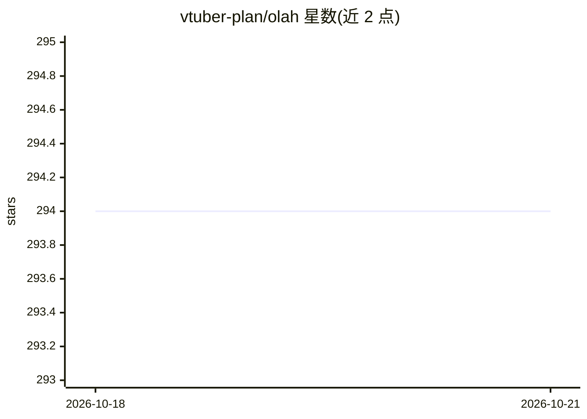

# vtuber-plan/olah

⭐ 295 · Python · MIT · 推送 2026-10-14 · [GitHub](https://github.com/vtuber-plan/olah) · 组织维护 · 中文 README

**自建 Hugging Face 镜像缓存服务，加速模型/数据集下载**

自托管轻量 HuggingFace 镜像服务：在用户下载时按文件块级别缓存资源，后续下载直接命中缓存；而非整站同步或简单反向代理。支持 Models、Datasets、Spaces 镜像，通过设置 HF_ENDPOINT 环境变量即可让 huggingface_hub 走该镜像。提供 pip、源码、Docker（amd64/arm64）三种安装方式，通过 configs.toml 配置缓存大小上限、LRU/FIFO 等清理策略、仓库访问与缓存白名单（支持正则/通配符）、离线模式与 HTTPS。限制：不同版本间缓存数据不可迁移，升级需删除缓存目录。

## 筛选速览

| 维度 | 判定 | 备注 |
|---|---|---|
| AI 角色 | `ai-ecosystem` | LLM/agent 周边工具 |
| 许可风险 | `permissive` | MIT |
| 部署形态 | `self-host` | docker 或自建部署 |
| 模型依赖 | — | README 未给出锁定关系 |
| 硬件要求 | — | 无带数字的原话,不猜 |
| 安装摩擦 | `low` | 无编译、无系统依赖或容器化 |
| 成熟度 | — | 结构信号不足 |

## 能力要点

- 下载时按文件块级缓存，后续下载直接从缓存获取
- 缓存控制策略：大小上限、LRU/FIFO/LARGE_FIRST 清理、离线模式
- 仓库访问与缓存白名单配置（通配符/正则）
- 多架构 Docker 镜像与 docker compose 部署方案

## 适用场景

- 国内或受限网络环境加速 HuggingFace 模型与数据集下载
- 组织内共享缓存节省带宽、支撑高并发下载
- 只允许访问指定仓库的受控镜像服务

## 场景标签

 · 领域:AI 基础设施/模型分发

## 证据(README 行号)

> L5: Olah is a self-hosted lightweight huggingface mirror service. `Olah` means `hello` in Hilichurlian.
> L6: Olah implemented the `mirroring` feature for huggingface resources, rather than just a simple `reverse proxy`.
> L16: * Huggingface Data Cache

## 星数曲线

2026-10-18 294 → 2026-10-21 294（+0）

---
*卡片 v1 · prompt 1.4 · 生成 2026-10-22 · 置信度 high · 依据 README sha `d698ae83ad3e` · [字段定义](../../DATASET.md)*
