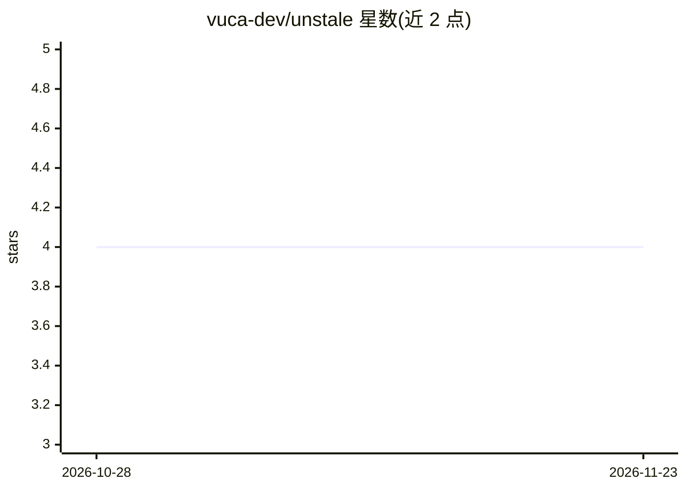

# vuca-dev/unstale

⭐ 4 · Rust · AGPL-3.0 · 推送 2026-11-22 · [GitHub](https://github.com/vuca-dev/unstale) · [官网](https://unstale.sh) · 组织维护

**向编码 agent 通报所用依赖库的上游变更的 CLI**

以 npm 包形式分发的 CLI（@unstale/cli），监控所用包的 release notes、迁移指南与安全通告，检测哪些变更（新 API、破坏性变更、弃用、安全修复）适用于仓库代码，并通过安装到 Claude Code、Codex、Cursor、opencode 的 review skill 与 session-start hook 告知 agent。每条结论附引用出处；释放说明由用户自选 provider 的小模型读取，代码与文件路径不外传；bump 摘要与安全通告路径无模型调用。支持 npm/PyPI/crates.io 三个生态，版本取自 lockfile。

## 筛选速览

| 维度 | 判定 | 备注 |
|---|---|---|
| AI 角色 | `ai-ecosystem` | LLM/agent 周边工具 |
| 许可风险 | `viral` | AGPL-3.0 |
| 部署形态 | `library` | 以包/库形式分发 |
| 模型依赖 | — | README 未给出锁定关系 |
| 硬件要求 | — | 无带数字的原话,不猜 |
| 安装摩擦 | `low` | 无编译、无系统依赖或容器化 |
| 成熟度 | — | 结构信号不足 |

## 能力要点

- 覆盖 npm、PyPI、crates.io，版本读取 npm/pnpm/Yarn/uv/Poetry/PDM/Pipenv/Cargo lockfile
- 每条变更引用其 release note、迁移指南、文档页或通告来源
- bump 摘要、发布者弃用与 OSV lockfile 通告无需模型调用
- 读取 release notes 的 provider 与月度 token 上限由用户配置

## 适用场景

- 依赖升级前了解大版本迁移对当前代码的具体影响
- 让编码 agent 在改动前知道依赖的破坏性变更与安全修复
- 追踪已安装依赖中被发布者弃用或 yanked 的包

## 场景标签

 · 领域:开发者工具/依赖与供应链情报

## 证据(README 行号)

> L10: unstale (`@unstale/cli`, unstale.sh) monitors release notes, migration guides and security
> L87: - **Agents:** Claude Code, Codex, Cursor, opencode
> L106: unstale reads new release notes with a small model, on the provider you choose. On your own API key that costs

## 星数曲线

2026-10-28 4 → 2026-11-23 4（+0）

---
*卡片 v1 · prompt 1.4 · 生成 2026-11-21 · 置信度 mid · 依据 README sha `6c067e26207e` · [字段定义](../../DATASET.md)*
