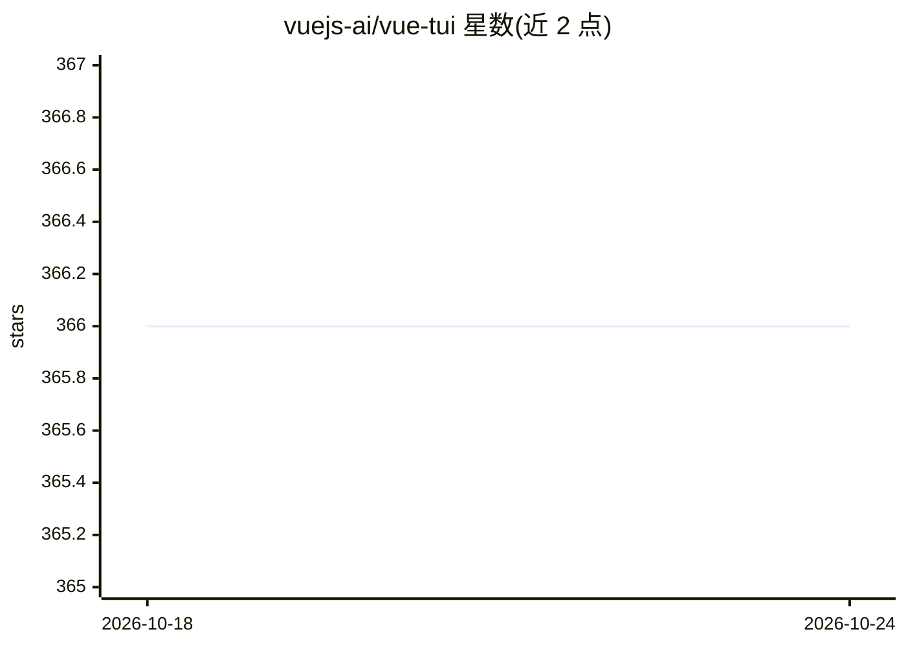

# vuejs-ai/vue-tui

⭐ 366 · TypeScript · MIT · 推送 2026-09-07 · [GitHub](https://github.com/vuejs-ai/vue-tui) · 组织维护

**用 Vue 构建交互式终端 UI 的应用框架**

基于 Vue 3 的终端 UI 渲染与应用框架：以 Vue 3 渲染器驱动终端界面，支持 SFC 与 JSX/TSX 语法、Yoga 弹性布局（与 React Native 同引擎）、Vite 插件提供终端 HMR 与打包、测试包提供确定性组件渲染与终端仿真检查。分为 runtime/use/components/vite/testing 五个 npm 包，支持独立 TUI 应用脚手架与嵌入既有 Node 应用两种接入方式。仓库含 AI coding agent（LLM 流式输出）等示例。当前处于 Public beta，runtime API 向 1.0 稳定中，HMR 仍为实验性。

## 筛选速览

| 维度 | 判定 | 备注 |
|---|---|---|
| AI 角色 | `ai-ecosystem` | LLM/agent 周边工具 |
| 许可风险 | `permissive` | MIT |
| 部署形态 | `desktop` | 安装包/桌面程序 |
| 模型依赖 | — | README 未给出锁定关系 |
| 硬件要求 | — | 无带数字的原话,不猜 |
| 安装摩擦 | `low` | 无编译、无系统依赖或容器化 |
| 成熟度 | `idea` | |

## 能力要点

- Vue 3 终端渲染器：SFC/JSX、Yoga flexbox 布局
- @vue-tui/vite 提供终端 HMR 与生产打包
- @vue-tui/testing 提供确定性测试宿主（frames/screen 检查）
- 输入/焦点/生命周期 composables（useInput/useFocus/useApp 等）

## 适用场景

- 用 Vue 组件语法开发命令行交互应用
- 为 AI coding agent 构建带流式输出的终端界面
- 对终端 UI 组件做确定性渲染测试

## 场景标签

 · 领域:终端 UI/前端框架

## 证据(README 行号)

> L82: |`coding-agent`|AI coding agent with LLM streaming and interactive UI|
> L5: vue-tui is a Vue-native application framework for interactive terminal UIs.

## 星数曲线

2026-10-18 366 → 2026-10-24 366（+0）

---
*卡片 v1 · prompt 1.4 · 生成 2026-10-21 · 置信度 high · 依据 README sha `6c9be4ae852c` · [字段定义](../../DATASET.md)*
