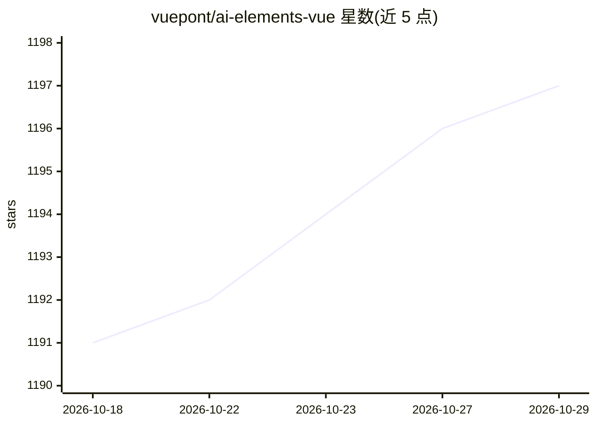

# vuepont/ai-elements-vue

⭐ 1,197 · Vue · NOASSERTION · 推送 2026-10-11 · [GitHub](https://github.com/vuepont/ai-elements-vue) · [官网](https://www.ai-elements-vue.com) · 组织维护

**面向 Vue/Nuxt 的 AI 应用 UI 组件库（基于 shadcn-vue）**

构建在 shadcn-vue 之上的 Vue 组件库，为 AI 应用提供预制可定制组件，覆盖 Chatbot（对话、消息、推理展示、工具可视化、来源引用等）、Workflow（VueFlow 画布与节点连线）、Vibe-Coding（artifact、web 预览）、文档与工具类共 30 余个。通过 CLI（npx ai-elements-vue）或 shadcn-vue CLI 从组件 registry 安装，组件落入用户代码库可完全定制。要求 Node.js 18+、已装 AI SDK 并初始化 shadcn-vue 与 Tailwind CSS（仅支持 CSS Variables 模式）。

## 筛选速览

| 维度 | 判定 | 备注 |
|---|---|---|
| AI 角色 | `ai-ecosystem` | LLM/agent 周边工具 |
| 许可风险 | `none` | NOASSERTION |
| 部署形态 | `library` | 以包/库形式分发 |
| 模型依赖 | — | README 未给出锁定关系 |
| 硬件要求 | — | 无带数字的原话,不猜 |
| 安装摩擦 | `low` | 无编译、无系统依赖或容器化 |
| 成熟度 | — | 结构信号不足 |

## 能力要点

- 30+ AI 场景组件：对话、推理展示、工具调用可视化、来源引用等
- CLI 自动检测包管理器（npm/pnpm/yarn/bun）并经 shadcn-vue CLI 安装组件
- Workflow 组件基于 VueFlow 提供画布/节点/连线
- 组件安装进用户代码库，可完全定制

## 适用场景

- 为 Vue/Nuxt AI 应用快速搭建聊天与对话界面
- 构建带推理过程、工具调用可视化的 agent 界面
- 搭建工作流可视化编辑画布

## 场景标签

 · 领域:前端/UI 组件

## 证据(README 行号)

> L17: AI Elements Vue provides pre-built, customizable Vue components specifically designed for AI applications, includin
> L36: - **Vue.js, Nuxt.js** project with AI SDK installed

## 星数曲线

2026-10-18 1,191 → 2026-10-29 1,197（+6）

---
*卡片 v1 · prompt 1.4 · 生成 2026-10-21 · 置信度 high · 依据 README sha `6a56291444ba` · [字段定义](../../DATASET.md)*
