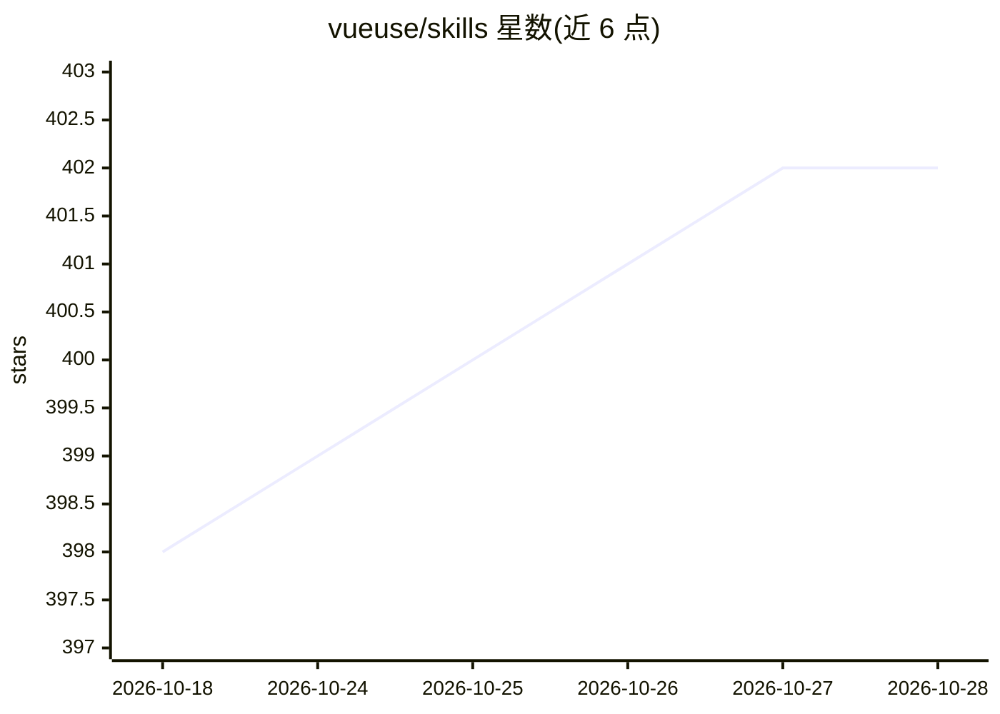

# vueuse/skills

⭐ 402 · TypeScript · MIT · 推送 2026-09-16 · [GitHub](https://github.com/vueuse/skills) · 组织维护

**帮助 AI agent 准确使用 VueUse 的技能包**

为 VueUse（Vue 组合式工具函数库）提供的 Agent Skills 集合，目标是让 AI agent 以更少 token、更准确地使用该库。机制包括渐进式披露（先发函数概览，按需加载详细用法与类型声明）、离线优先设计、可自定义调用规则（覆盖 AGENTS.md）。通过 npx skills 或 Claude Code 插件市场安装，装于 Vue/Nuxt 项目后 agent 自动调用。自述为实验性项目。

## 筛选速览

| 维度 | 判定 | 备注 |
|---|---|---|
| AI 角色 | `ai-ecosystem` | LLM/agent 周边工具 |
| 许可风险 | `permissive` | MIT |
| 部署形态 | `library` | 以包/库形式分发 |
| 模型依赖 | — | README 未给出锁定关系 |
| 硬件要求 | — | 无带数字的原话,不猜 |
| 安装摩擦 | `low` | 无编译、无系统依赖或容器化 |
| 成熟度 | `idea` | |

## 能力要点

- 渐进式披露：先函数概览，按需加载详细用法与类型声明
- 离线优先，无需联网或额外 agent 权限
- 用户可在 prompts 或 AGENTS.md 中覆盖函数调用规则
- 通过 npx skills 或 Claude Code 插件市场安装

## 适用场景

- 让 AI agent 在 Vue/Nuxt 项目中正确调用 VueUse 函数
- 减少 agent 编造不存在的 VueUse API
- 在 token 受限场景下按需加载库文档

## 场景标签

 · 领域:前端开发/AI 工具

## 证据(README 行号)

> L5: Agent Skills for VueUse — a collection of essential Vue Composition Utilities.
> L10: - 🪜 Progressive disclosure: send VueUse function overviews first, then load detailed usage and type declarations on

## 星数曲线

2026-10-18 398 → 2026-10-28 402（+4）

---
*卡片 v1 · prompt 1.4 · 生成 2026-10-21 · 置信度 high · 依据 README sha `59e0003860e8` · [字段定义](../../DATASET.md)*
