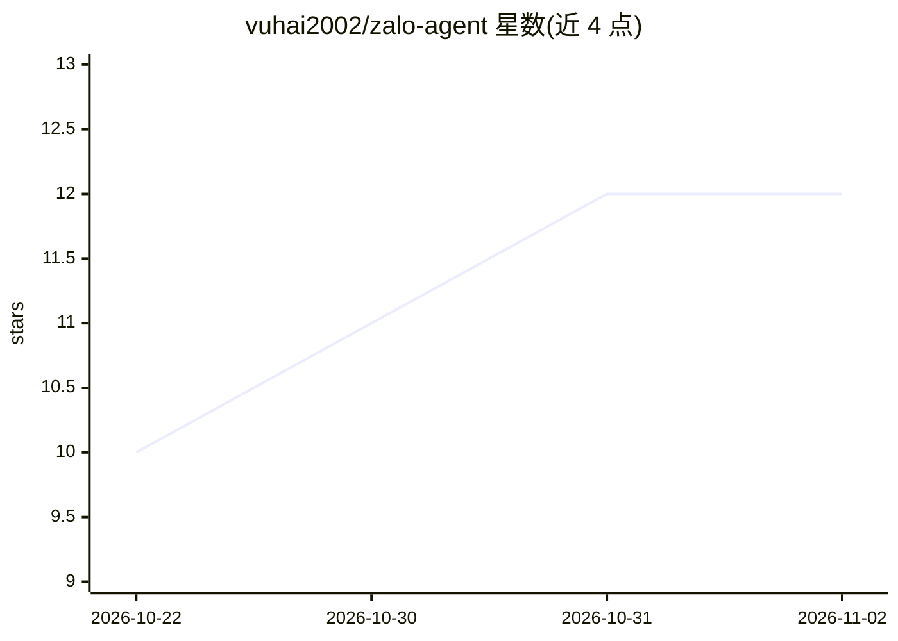

# vuhai2002/zalo-agent

⭐ 12 · TypeScript · MIT · 推送 2026-10-25 · [GitHub](https://github.com/vuhai2002/zalo-agent) · 个人维护

**自托管的 Zalo 聊天 AI agent，多账号、15 工具、Web 仪表盘**

部署在自己服务器上的 AI agent，运行于 Zalo 个人账号（zca-js，非官方）或 Zalo Bot 官方账号两种渠道，单进程可混跑多账号且各配独立 persona、模型与工具集。内置 15 个工具（网页搜索/抓取、知识库检索、长期记忆、定时任务、画图、生成 docx/xlsx 等），可外接 MCP server（仅 HTTP），LLM 供应商无关：任意 OpenAI 兼容端点或 Anthropic。技术栈 TypeScript + SQLite + Hono/React，自带 Web 仪表盘（70 项热更配置、Trace 回放）。个人账号渠道有封号风险，README 建议仅用小号。MIT 许可。

## 筛选速览

| 维度 | 判定 | 备注 |
|---|---|---|
| AI 角色 | `ai-native` | 本体是模型或模型工具 |
| 许可风险 | `permissive` | MIT |
| 部署形态 | `library` | 以包/库形式分发 |
| 模型依赖 | — | README 未给出锁定关系 |
| 硬件要求 | — | 无带数字的原话,不猜 |
| 安装摩擦 | `low` | 无编译、无系统依赖或容器化 |
| 成熟度 | — | 结构信号不足 |

## 能力要点

- 个人账号与官方 Bot 双渠道，单进程多账号各自独立“大脑”
- 15 个内置工具 + 外接 MCP server（仅 HTTP，默认关闭、需逐 agent 授权）
- SQLite FTS5 + bm25 + RRF 的知识库检索（RAG），内容按需经工具注入
- Web 仪表盘：QR 登录、会话回放、Trace、70 项免重启配置

## 适用场景

- 在自己的 Zalo 账号上跑一个私人 AI 助手，聊天中搜网、画图、记账提醒
- 小团队把公司政策/价目表喂给 agent，在群聊里做内部问答
- 给不同账号配不同 persona 与工具权限，多号共管

## 场景标签

`聊天机器人` `AI 助手` · 领域:对话与助手

## 证据(README 行号)

> L3: Agent AI thường trú trên Zalo. Chạy được trên hai loại kênh : tài khoản Zalo cá nhân (qua zca-js)
> L5: mỗi account một "não" riêng, 15 công cụ, dashboard web đầy đủ. Tự host, không phụ thuộc nhà cung cấp LLM nào.
> L22: Luồng một lượt: **tin Zalo -> lọc (allowlist, @mention) -> gộp theo thread -> agent loop (LLM tự

## 星数曲线

2026-10-22 10 → 2026-11-02 12（+2）

---
*卡片 v1 · prompt 1.4 · 生成 2026-10-31 · 置信度 high · 依据 README sha `cb73e548e7b7` · [字段定义](../../DATASET.md)*
