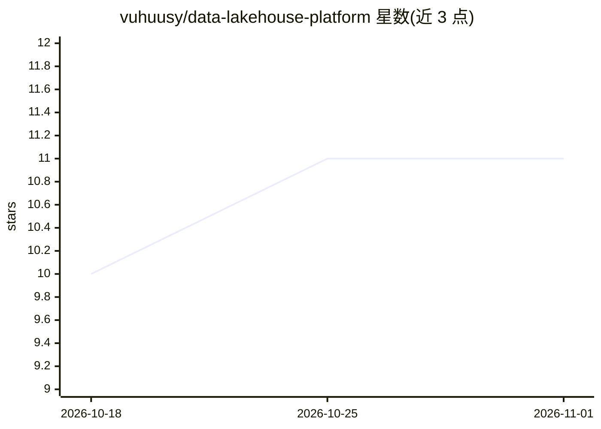

# vuhuusy/data-lakehouse-platform

⭐ 11 · Python · Apache-2.0 · 推送 2026-03-16 · [GitHub](https://github.com/vuhuusy/data-lakehouse-platform) · [官网](https://www.linkedin.com/in/vu-huu-sy/) · 个人维护

**基于 Data Lakehouse 架构的实时欺诈检测平台（K8s 部署）**

展示用可扩展实时欺诈检测系统：以 Data Lakehouse 架构整合批流数据管道，集成 Flink、Kafka、Spark、Delta Lake 与 MLflow，支持低延迟推理、特征增强与端到端可观测性。安装路径为在 Ubuntu 主机上用 Ansible 准备环境，经 Docker 运行 Rancher，创建 RKE2 Kubernetes 集群，再通过 Makefile 依次部署 Prometheus、Longhorn、Minio、Airflow、Kafka、Spark/Flink Operator、Hive、Trino、Superset、MLflow、Feast、Datahub 等服务。演示应用运行说明标注为 TODO，采用 Apache 2.0 许可。

## 筛选速览

| 维度 | 判定 | 备注 |
|---|---|---|
| AI 角色 | `ai-ecosystem` | LLM/agent 周边工具 |
| 许可风险 | `permissive` | Apache-2.0 |
| 部署形态 | `self-host` | docker 或自建部署 |
| 模型依赖 | — | README 未给出锁定关系 |
| 硬件要求 | — | 无带数字的原话,不猜 |
| 安装摩擦 | `low` | 无编译、无系统依赖或容器化 |
| 成熟度 | — | 结构信号不足 |

## 能力要点

- 整合 Flink/Kafka/Spark/Delta Lake/MLflow 的批流一体架构
- Ansible + Rancher + RKE2 的 Kubernetes 集群搭建流程
- 通过 Makefile 部署约 15 个数据平台组件（含 Feast 特征库、Datahub 数据目录）

## 适用场景

- 搭建实时欺诈检测的数据平台参考架构
- 学习在 Kubernetes 上编排大数据与 MLOps 组件
- 构建批流一体 Lakehouse 管道

## 场景标签

`MLOps` · 领域:训练与推理

## 证据(README 行号)

> L9: This project demonstrates a scalable real-time fraud detection system built on a modern Data Lakehouse architecture.

## 星数曲线

2026-10-18 10 → 2026-11-01 11（+1）

---
*卡片 v1 · prompt 1.4 · 生成 2026-11-01 · 置信度 mid · 依据 README sha `832132572496` · [字段定义](../../DATASET.md)*
