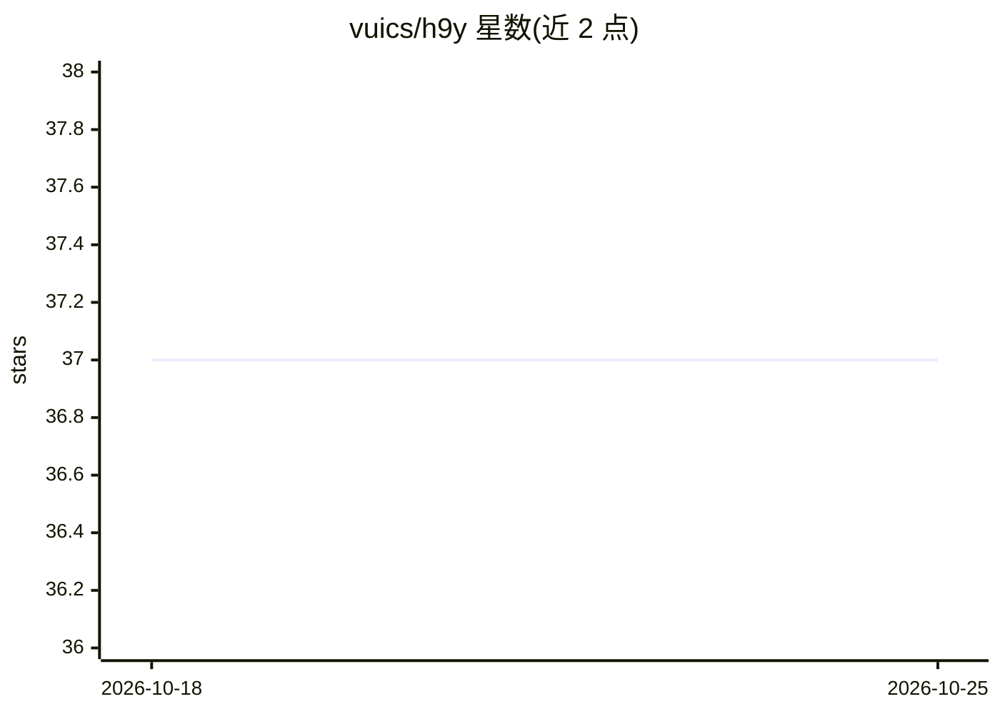

# vuics/h9y

⭐ 37 · JavaScript · NOASSERTION · 推送 2026-10-20 · [GitHub](https://github.com/vuics/h9y) · [官网](https://h9y.ai) · 组织维护

**联邦式自主 Agent 操作系统网络，含多层记忆与分布式运行时**

面向组织与多用户部署的开源 Agent 基础设施，由多用户操作系统、多层记忆架构（结构/交互/运行时/区块链等 9 层，分别落在 MongoDB、PostgreSQL、Redis、Hyperledger 等技术）和分布式 Agent 运行时三层组成。Agent 以容器内临时执行单元运行，采用 Redis 租约+心跳的执行模型，实例间通过 XMPP S2S 联邦互通，消息仅存于收发双方实例。声明模型无关，支持云端或本地容器化部署。

## 筛选速览

| 维度 | 判定 | 备注 |
|---|---|---|
| AI 角色 | `ai-ecosystem` | LLM/agent 周边工具 |
| 许可风险 | `none` | NOASSERTION |
| 部署形态 | `self-host` | docker 或自建部署 |
| 模型依赖 | local-ok | 支持本地模型 |
| 硬件要求 | — | 无带数字的原话,不猜 |
| 安装摩擦 | `low` | 无编译、无系统依赖或容器化 |
| 成熟度 | — | 结构信号不足 |

## 能力要点

- 9 层专用记忆架构（MongoDB/PostgreSQL/Redis/OpenSearch/Ollama 等）
- 基于 Redis 租约、心跳与分布式锁的 Agent 执行模型，可迁移、可恢复
- XMPP S2S 联邦：实例间用户与 Agent 跨组织安全通信，无全局共享会话库
- Agent 生命周期管理、cron/事件驱动调度、MCP/CLI/API 外部工具运行时

## 适用场景

- 组织内部署多用户、多 Agent 的自主工作流平台
- 多个组织间建立联邦化的 Agent 协作网络并保留数据主权
- 运行需要长期记忆与分布式执行的有状态 Agent 系统

## 场景标签

`Agent 记忆` `多智能体` `工作流自动化` `Agent 框架` · 领域:Agent 开发

## 证据(README 行号)

> L12: > **HyperAgency** is a sovereign, federated, and distributed Agentic AI Operating System Network composed of three 
> L143: HyperAgency is not only a messaging and memory system — it is a **distributed execution runtime for autonomous age
> L240: |Model & Capability Memory|Runtime AI models and multimodal capabilities (LLM, VLM, STT, TTS, RAG)|Ollama, Speache

## 星数曲线

2026-10-18 37 → 2026-10-25 37（+0）

---
*卡片 v1 · prompt 1.4 · 生成 2026-10-25 · 置信度 mid · 依据 README sha `8d615504ca25` · [字段定义](../../DATASET.md)*
