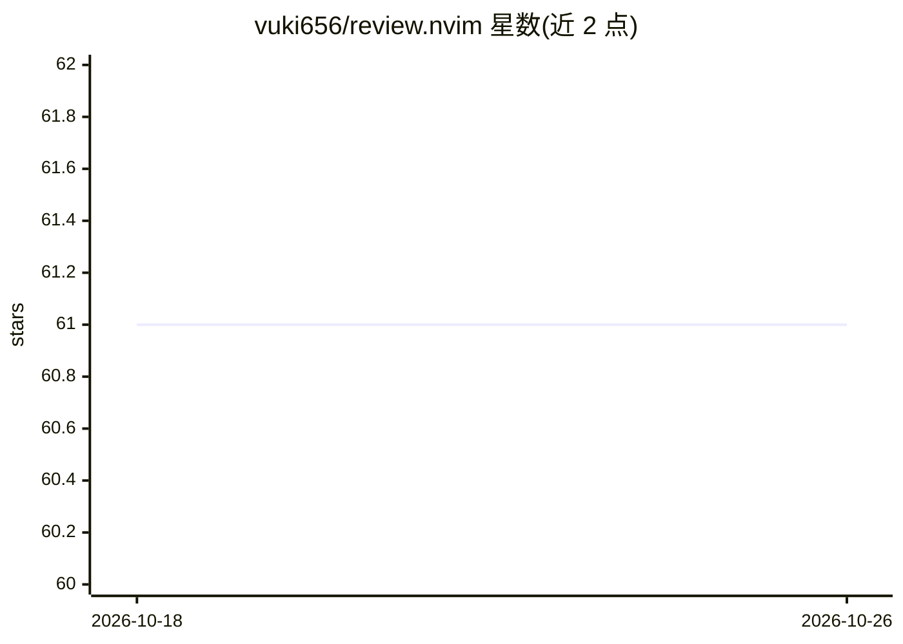

# vuki656/review.nvim

⭐ 61 · Lua · MIT · 推送 2026-09-23 · [GitHub](https://github.com/vuki656/review.nvim) · 个人维护

**Neovim 插件：浏览 git diff、逐行批注并导出给 AI agent**

用 Lua 编写的 Neovim 插件，在专用标签页中以浮动窗口提供 diff 浏览：侧栏含分支、提交、文件树与评论面板，右侧显示 unified 或 side-by-side diff。用户可在 diff 行上添加类型化评论（note/fix/question），支持模板选择、快速评论（任意 buffer 任意行，带 gutter 标记）与会话持久化。评论可导出为带 diff 上下文的 markdown，复制到剪贴板或通过 tmux/herdr 面板发送给 AI agent。内嵌 git 操作（stage/commit/push/pull/checkout 等），并在 agent 写文件时自动刷新。要求 Neovim 0.10+ 与 git；tmux/herdr、nvim-web-devicons、Tree-sitter 解析器均为可选。

## 筛选速览

| 维度 | 判定 | 备注 |
|---|---|---|
| AI 角色 | `ai-enhanced` | 去掉 AI 部分产品仍成立 |
| 许可风险 | `permissive` | MIT |
| 部署形态 | `None` |  |
| 模型依赖 | — | README 未给出锁定关系 |
| 硬件要求 | — | 无带数字的原话,不猜 |
| 安装摩擦 | `low` | 无编译、无系统依赖或容器化 |
| 成熟度 | — | 结构信号不足 |

## 能力要点

- 专用标签页 diff 浏览：文件树、分支、提交、评论四面板
- 类型化评论（note/fix/question）附在具体 diff 行，含模板选择
- 评论导出为带 diff 上下文的 markdown，可发送到 tmux/herdr 面板给 AI agent
- agent 写文件时自动刷新，评论会话持久化

## 适用场景

- 在 Neovim 内审阅自己的 git diff 并逐行记录意见
- 把审阅批注整理成 markdown 发给正在干活的 AI agent
- 审查 AI agent 修改过的代码并留下反馈

## 场景标签

`代码审查` · 领域:编码与开发

## 证据(README 行号)

> L1: ## Review git diffs in Neovim, comment on lines, send the comments to your AI agent
> L12: - Export all comments as markdown with diff context, to the clipboard or a tmux/herdr pane

## 星数曲线

2026-10-18 61 → 2026-10-26 61（+0）

---
*卡片 v1 · prompt 1.4 · 生成 2026-10-24 · 置信度 high · 依据 README sha `1fbf577b455b` · [字段定义](../../DATASET.md)*
