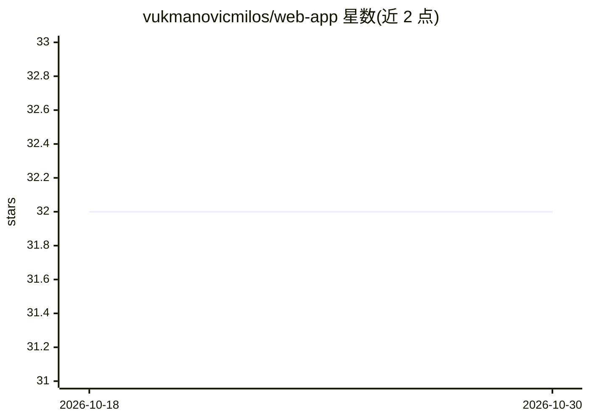

# vukmanovicmilos/web-app

⭐ 32 · Java · 推送 2026-03-09 · [GitHub](https://github.com/vukmanovicmilos/web-app) · 个人维护

**Java 开发者的 Spring Boot 微服务 + OpenAI 集成演示应用**

演示型微服务工程，展示 Spring Boot 3 / Java 21 技术栈下的微服务架构：API Gateway、Eureka 服务发现、Config Server 配置中心，以及 Faculty、Report、OpenAI 三个业务服务。OpenAI 微服务基于 Spring AI 调用 GPT 模型生成摘要，将学生数据同步到 pgvector 向量库，并实现 RAG 检索问答；Report 服务经 Feign 同步调用生成课程摘要并用 Jasper Reports 输出 PDF。运行需 Java 21、Maven、Docker，通过 docker compose 启动并配置 API key。

## 筛选速览

| 维度 | 判定 | 备注 |
|---|---|---|
| AI 角色 | `ai-ecosystem` | LLM/agent 周边工具 |
| 许可风险 | `none` | — |
| 部署形态 | `self-host` | docker 或自建部署 |
| 模型依赖 | — | README 未给出锁定关系 |
| 硬件要求 | — | 无带数字的原话,不猜 |
| 安装摩擦 | `low` | 无编译、无系统依赖或容器化 |
| 成熟度 | — | 结构信号不足 |

## 能力要点

- OpenAI 微服务提供摘要生成、向量库数据同步与 RAG 问答三项功能
- 基于 Spring AI Chat Client 与 Spring AI Vector Store，pgvector 支持相似度检索
- 完整微服务组件：API Gateway / Eureka / Config Server / Kafka
- docker compose 一键启动全部服务

## 适用场景

- 学习 Spring Boot 微服务架构的组成与协作方式
- 参考 Spring AI 集成 OpenAI 与 RAG 的实现
- 了解 pgvector 向量库与 Kafka 在微服务中的用法

## 场景标签

`RAG` · 领域:知识与检索

## 证据(README 行号)

> L7: This demo application showcases the implementation of Spring Boot microservices, highlighting their powerful feature
> L71: The OpenAI Microservice integrates with OpenAI's API to provide advanced AI functionalities. OpenAI is an artificia
> L82: 3. **RAG (Retrieval-Augmented Generation)**: Performs similarity searches for a given question over the local vecto

## 星数曲线

2026-10-18 32 → 2026-10-30 32（+0）

---
*卡片 v1 · prompt 1.4 · 生成 2026-10-25 · 置信度 high · 依据 README sha `6228577e93ce` · [字段定义](../../DATASET.md)*
