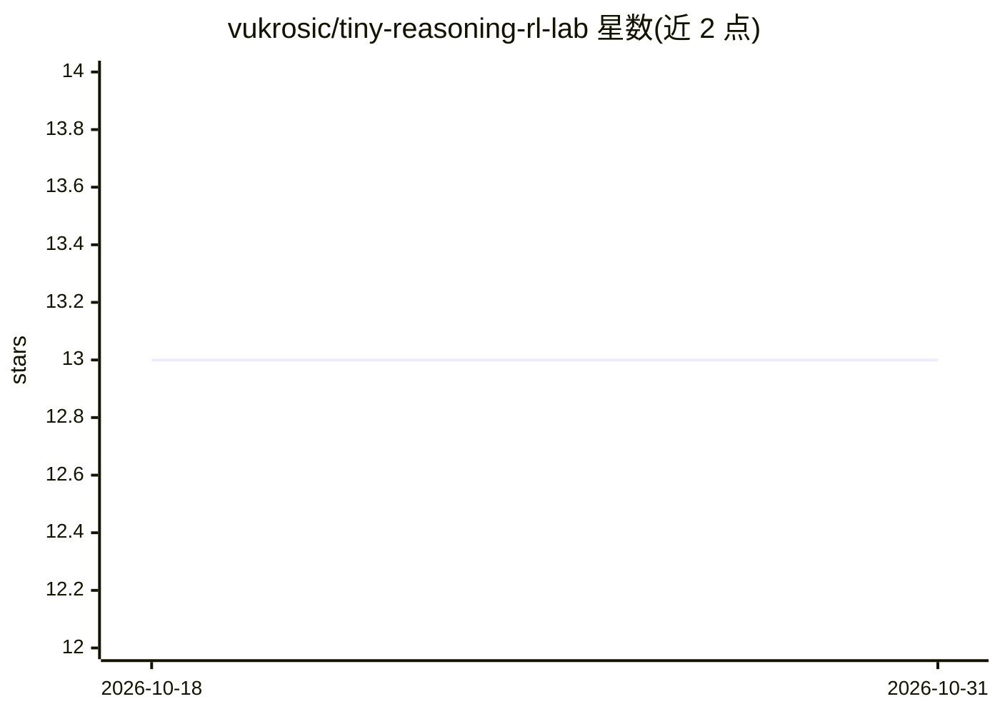

# vukrosic/tiny-reasoning-rl-lab

⭐ 13 · Python · MIT · 推送 2026-08-23 · [GitHub](https://github.com/vukrosic/tiny-reasoning-rl-lab) · 个人维护

**CPU 上训练微型 Transformer 学两步算术的 RL 教学实验**

教学型强化学习实验仓库：训练一个 41,328 参数的解码器 Transformer 完成固定两步算术任务（先加后乘），监督初始化后进行带 KL 惩罚的组相对 REINFORCE 风格更新，奖励由 Python 程序验证（格式/加法/乘法/最终答案分项计分）。全程 CPU 运行，首跑自动下载 CPU PyTorch，训练耗时数秒。提供三级渐进任务：直接运行预测结果、对比不同 group size、自行实现奖励函数。限制：同一 50 题用于奖励与评估，未验证对未见题目的泛化；非完整 GRPO 实现。

## 筛选速览

| 维度 | 判定 | 备注 |
|---|---|---|
| AI 角色 | `ai-ecosystem` | LLM/agent 周边工具 |
| 许可风险 | `permissive` | MIT |
| 部署形态 | `desktop` | 安装包/桌面程序 |
| 模型依赖 | — | README 未给出锁定关系 |
| 硬件要求 | — | 无带数字的原话,不猜 |
| 安装摩擦 | `low` | 无编译、无系统依赖或容器化 |
| 成熟度 | — | 结构信号不足 |

## 能力要点

- 41,328 参数微型解码器 Transformer，CPU 上数秒完成训练
- 可验证的分项奖励（格式 0.10/加法 0.25/乘法 0.35/答案 0.30）
- 三级渐进任务：运行预测 → 改 group size 对比 → 自写奖励函数
- GitHub Actions 覆盖 Linux/macOS/Windows 验证

## 适用场景

- 初学者直观体验 RL 让小模型推理能力变化
- 对比不同 group size 对组相对策略优化的影响
- 动手实现并检验自定义奖励函数

## 场景标签

`强化学习` `教程课程` · 领域:学习与行业

## 证据(README 行号)

> L3: Train a 41,328-parameter decoder-only transformer on a fixed two-step arithmetic
> L5: is followed by group-relative REINFORCE-style updates with a KL penalty. It runs
> L131: This is group-relative REINFORCE-style policy optimization with a KL penalty.

## 星数曲线

2026-10-18 13 → 2026-10-31 13（+0）

---
*卡片 v1 · prompt 1.4 · 生成 2026-10-31 · 置信度 high · 依据 README sha `0d5b0708ee70` · [字段定义](../../DATASET.md)*
