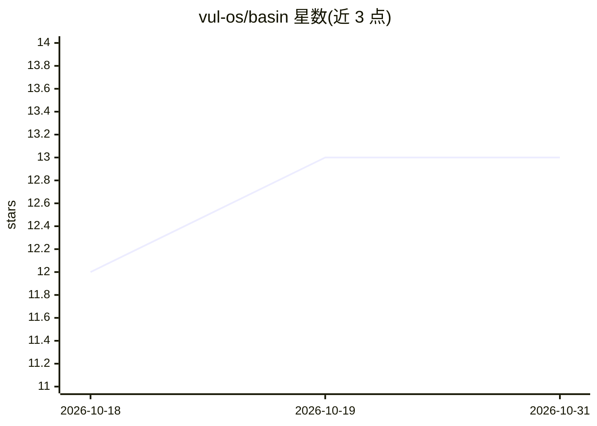

# vul-os/basin

⭐ 13 · Rust · Apache-2.0 · 推送 2026-08-14 · [GitHub](https://github.com/vul-os/basin) · [官网](https://vulos.org/projects/basin) · 组织维护

**面向开发者的自托管 serverless Postgres：S3 桶上的列式多租户数据库**

Rust 编写的自托管数据库：pgwire 协议接入、Vortex 压缩列式文件存储在任意 S3 兼容桶上，项目即 S3 前缀而非预置实例，路由无状态、计算存储分离，宣称每连接约 310 KiB RAM。支持原生向量检索、Iceberg 快照时间旅行、pg_cron/pg_net/PostGIS 子集的本地 crate 实现。README 公开与 Postgres 的全面对比数据（含多项落后项），并披露默认写路径在 fsync 前确认（≤200ms 有界丢失窗口）。当前为 pre-alpha 公开评估阶段，面向评估成本模型与多租户原型的开发者。

## 筛选速览

| 维度 | 判定 | 备注 |
|---|---|---|
| AI 角色 | `ai-enhanced` | 去掉 AI 部分产品仍成立 |
| 许可风险 | `permissive` | Apache-2.0 |
| 部署形态 | `self-host` | docker 或自建部署 |
| 模型依赖 | — | README 未给出锁定关系 |
| 硬件要求 | — | 无带数字的原话,不猜 |
| 安装摩擦 | `low` | 无编译、无系统依赖或容器化 |
| 成熟度 | `idea` | |

## 能力要点

- 项目即 S3 前缀，空闲项目仅按字节计成本（约 $0.10/月/项目）
- pgwire v3 前端（TLS、COPY、扩展查询、JSONB/UUID/BYTEA）
- 原生向量检索与 Iceberg 快照时间旅行
- 公开与 Postgres 的完整胜负对比基准数据

## 适用场景

- 多租户 SaaS 为每个租户开独立项目，成本随活跃字节而非实例数增长
- 审计日志、事件流、IoT 等 append-heavy 写少读多场景
- 评估对象存储上的 OLTP/HTAP 成本经济性原型

## 场景标签

`向量数据库` · 领域:知识与检索

## 证据(README 行号)

> L5:  Serverless Postgres on your own bucket.
> L22: are separated, the routers are stateless, and a project is an S3 prefix rather
> L57: Everything else — Vortex columnar storage, native vector search, basin-auth + basin-rest, time travel via Iceberg s

## 星数曲线

2026-10-18 12 → 2026-10-31 13（+1）

---
*卡片 v1 · prompt 1.4 · 生成 2026-10-31 · 置信度 high · 依据 README sha `d4c11ed97b52` · [字段定义](../../DATASET.md)*
