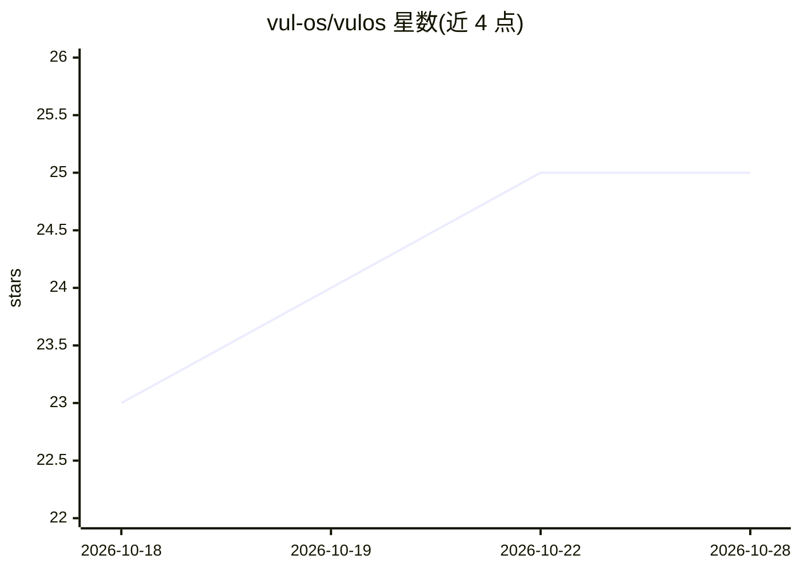

# vul-os/vulos

⭐ 25 · Go · Apache-2.0 · 推送 2026-08-26 · [GitHub](https://github.com/vul-os/vulos) · [官网](https://vulos.org) · 组织维护

**自托管的开源个人云操作系统：浏览器中的完整桌面与私有 AI 助手**

单二进制部署的自托管个人服务器：通过浏览器访问真实桌面（窗口拖拽/贴靠/平铺、Dock、命令面板），内置文件管理（权限/密封分享/断点续传）、日历、联系人、终端、应用中心与 WebRTC 应用串流。AI 部分为驻留在本机的助手，可读取日历/联系人/文件，副作用操作需用户确认；支持自带 provider key 或运行本地模型。多实例通过 Ed25519 身份与 CRDT 同步（当前仅账户/设置/提醒等白名单项，文件与密码不同步）。提供 Docker 镜像与源码构建两种运行方式。

## 筛选速览

| 维度 | 判定 | 备注 |
|---|---|---|
| AI 角色 | `ai-enhanced` | 去掉 AI 部分产品仍成立 |
| 许可风险 | `permissive` | Apache-2.0 |
| 部署形态 | `self-host` | docker 或自建部署 |
| 模型依赖 | — | README 未给出锁定关系 |
| 硬件要求 | — | 无带数字的原话,不猜 |
| 安装摩擦 | `low` | 无编译、无系统依赖或容器化 |
| 成熟度 | `idea` | |

## 能力要点

- 浏览器内真实窗口系统，无 Electron/VNC，支持虚拟桌面与持久会话
- 本机 AI 助手：读取个人数据，副作用操作以提案形式需确认
- 多实例以 CRDT + Ed25519 对等同步，NAT 环境可自建 relay 或直连
- 原生 Linux 应用经 WebRTC GPU 加速串流进桌面窗口

## 适用场景

- 把桌面、文件、日历和 AI 集中到自己控制的一台服务器上
- 在 NAT 后的自有主机上通过自建 relay 从任意设备访问
- 常开主机与笔记本多实例同步账户、设置与应用集

## 场景标签

`AI 助手` · 领域:对话与助手

## 证据(README 行号)

> L23: Vulos is a **sovereign personal server** — your own computer in the cloud (or in your closet) that you actually own
> L127: - **A sovereign AI assistant** — an on-box agent that knows your calendar, contacts, files, and reminders and can 

## 星数曲线

2026-10-18 23 → 2026-10-28 25（+2）

---
*卡片 v1 · prompt 1.4 · 生成 2026-10-26 · 置信度 mid · 依据 README sha `b9d0300c702f` · [字段定义](../../DATASET.md)*
