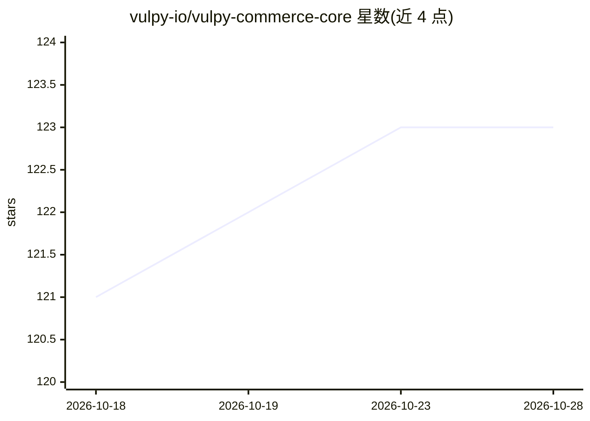

# vulpy-io/vulpy-commerce-core

⭐ 123 · JavaScript · Apache-2.0 · 推送 2026-09-16 · [GitHub](https://github.com/vulpy-io/vulpy-commerce-core) · [官网](https://vulpy.io/commerce) · 组织维护

**AI 助手 Fox 运营的开源电商全栈（Medusa v2 + Next.js + Payload CMS）**

Medusa v2 后端、Next.js 店面、Payload CMS 与自托管 Matomo 分析组成的可移植 monorepo 电商栈，由内置 AI 助手 Fox（Hermes agent + Vulpy WebUI）负责建店与日常运营：目录、内容、订单、分析，并在安装和持续运营中提供引导。提供 pnpm bootstrap 一键初始化（env、DB、迁移、种子数据、管理员、publishable key），PostgreSQL/Redis 经 Docker Compose 运行，数据落盘于 .data/ 目录，支持一台机器多店铺并行。分为免费 Core 版、付费 Starter/Multi-Agent Pack 与商业 Pro 版。

## 筛选速览

| 维度 | 判定 | 备注 |
|---|---|---|
| AI 角色 | `ai-enhanced` | 去掉 AI 部分产品仍成立 |
| 许可风险 | `permissive` | Apache-2.0 |
| 部署形态 | `self-host` | docker 或自建部署 |
| 模型依赖 | — | README 未给出锁定关系 |
| 硬件要求 | — | 无带数字的原话,不猜 |
| 安装摩擦 | `low` | 无编译、无系统依赖或容器化 |
| 成熟度 | — | 结构信号不足 |

## 能力要点

- 内置 AI 助手 Fox 负责建店与日常运营（目录/内容/订单/分析）
- Medusa v2 + Next.js + Payload CMS + PostgreSQL/Redis 全栈 monorepo
- pnpm bootstrap 一键初始化：env、DB、迁移、种子、管理员、publishable key
- COMPOSE_PROJECT_NAME 隔离，单机可运行多个店铺实例

## 适用场景

- 我需要一套可自托管的 AI 参与运营的电商系统
- 在单台机器/VPS 上复制多套独立店铺环境
- 自托管含 Matomo 合规分析的电商分析栈

## 场景标签

`AI 助手` · 领域:对话与助手

## 证据(README 行号)

> L6: Vulpy Commerce is an **AI-run shop**: the open-source Medusa v2 + Next.js +
> L8: (Hermes agent + Vulpy WebUI). Fox sets up the store, runs it day to day
> L9: (catalog, content, orders, analytics), and guides you through setup and ongoing

## 星数曲线

2026-10-18 121 → 2026-10-28 123（+2）

---
*卡片 v1 · prompt 1.4 · 生成 2026-10-23 · 置信度 low · 依据 README sha `9614f4e39f8a` · [字段定义](../../DATASET.md)*
