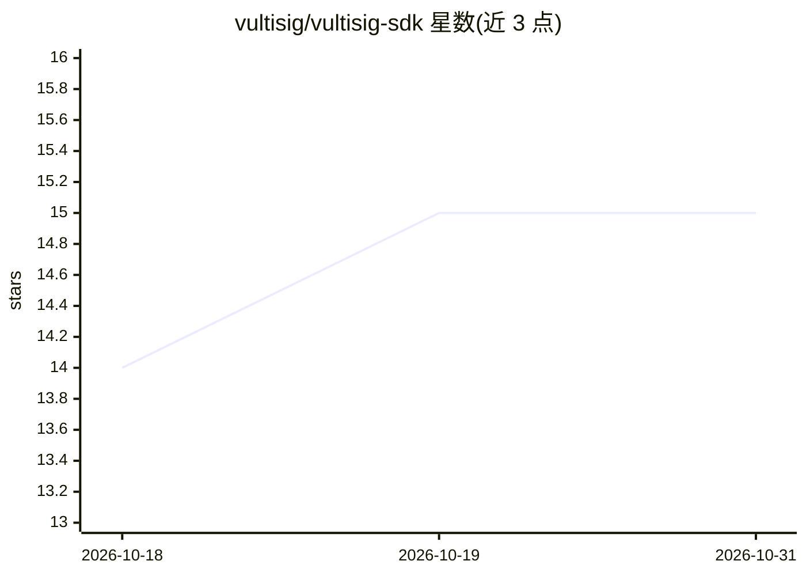

# vultisig/vultisig-sdk

⭐ 15 · TypeScript · MIT · 推送 2026-10-30 · [GitHub](https://github.com/vultisig/vultisig-sdk) · [官网](https://vultisig.com) · 组织维护

**面向 AI 代理与开发者的自托管 MPC 多链钱包 SDK/CLI**

TypeScript SDK 与 CLI，提供自托管 MPC 钱包能力：密钥分片、无助记词，支持 40+ 条链（Bitcoin/Ethereum/Cosmos/Solana 等）的发送、跨链兑换（THORChain/1inch/KyberSwap/LiFi 自动路由）、余额与组合查询、干跑预览。两种金库类型：Fast Vault（服务器辅助 2-of-2）与 Secure Vault（多设备 N-of-M 阈值签名）。CLI 内置 agent ask 自然语言命令，支持 --json 机器可解析输出，面向 AI 编码代理与机器人开发者。

## 筛选速览

| 维度 | 判定 | 备注 |
|---|---|---|
| AI 角色 | `ai-enhanced` | 去掉 AI 部分产品仍成立 |
| 许可风险 | `permissive` | MIT |
| 部署形态 | `library` | 以包/库形式分发 |
| 模型依赖 | — | README 未给出锁定关系 |
| 硬件要求 | — | 无带数字的原话,不猜 |
| 安装摩擦 | `low` | 无编译、无系统依赖或容器化 |
| 成熟度 | — | 结构信号不足 |

## 能力要点

- 40+ 链的发送与跨链兑换，自动路由
- MPC 密钥分片，无助记词，N-of-M 阈值签名
- CLI 内置 agent ask 自然语言代理命令与 --json 输出
- send/swap 支持 dry-run 干跑预览费用与输出

## 适用场景

- 为 AI 代理或机器人接入自托管多链钱包
- 构建自动化交易、监控与组合查询脚本
- 通过 CLI 以自然语言查询余额与执行链上操作

## 场景标签

 · 领域:区块链/加密基础设施

## 证据(README 行号)

> L3: The self-custodial multi-chain wallet SDK for AI agents and developers.
> L10: - **AI agent ready** — JSON output, programmatic API, designed for autonomous operation
> L46: |**Agent mode**|Build your own logic with `vault.send()`, `vault.swap()`|`vultisig agent ask "check my ETH balance"

## 星数曲线

2026-10-18 14 → 2026-10-31 15（+1）

---
*卡片 v1 · prompt 1.4 · 生成 2026-10-30 · 置信度 high · 依据 README sha `78736d94037b` · [字段定义](../../DATASET.md)*
