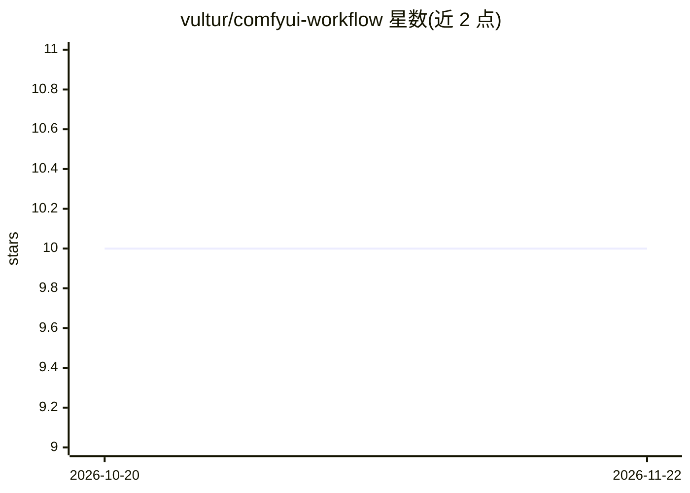

# vultur/comfyui-workflow

⭐ 10 · 推送 2026-05-16 · [GitHub](https://github.com/vultur/comfyui-workflow) · 个人维护 · 中文 README

**为 ComfyUI 用户整理的图像生成工作流模板与安装教程集**

该仓库收录 ComfyUI 工作流模板（*.json），按 Flux、Kolors、Lumina、HiDream、SDXL/SD3.5、Wan 等模型分节组织，内容涵盖初学者教程、参数测试（CFG、Steps、Guidance、Sampler 组合）、Florence2 提示词反推与图像生成模板。README 提供 ComfyUI 安装指引、Flux/CLIP/VAE 模型下载清单与模型文件放置目录说明，并按显存给出 FP8/GGUF 版本选择指引；另列可选插件（ComfyUI-GGUF、cg-use-everywhere 等）。仓库自带工作流模板，ComfyUI 需另行安装；使用云平台的用户可跳过安装步骤。

## 筛选速览

| 维度 | 判定 | 备注 |
|---|---|---|
| AI 角色 | `ai-knowledge` | 知识聚合/清单类 |
| 许可风险 | `none` | — |
| 部署形态 | `None` |  |
| 模型依赖 | — | README 未给出锁定关系 |
| 硬件要求 | — | 无带数字的原话,不猜 |
| 安装摩擦 | `low` | 无编译、无系统依赖或容器化 |
| 成熟度 | — | 结构信号不足 |

## 能力要点

- 按模型分节的工作流模板集合（Flux/Kolors/Lumina/HiDream/SDXL/Wan 等）
- Flux 参数测试工作流（CFG、Steps、Guidance、Sampler+Scheduler XY 图表）
- 按显存分级的模型版本指引（原始权重 >16GB / FP8 >12GB / GGUF >6GB）
- 列出 7 个可选 ComfyUI 插件及模型文件放置目录说明

## 适用场景

- 想在 ComfyUI 中导入现成模板直接生成图像
- 通过参数测试工作流了解采样参数对生成结果的影响
- 根据自己显卡显存选择合适的模型量化版本

## 场景标签

`图像生成` `教程课程` · 领域:内容生成

## 证据(README 行号)

> L3: # ComfyUI Workflow
> L116: ### Flux

## 星数曲线

2026-10-20 10 → 2026-11-22 10（+0）

---
*卡片 v1 · prompt 1.4 · 生成 2026-11-19 · 置信度 high · 依据 README sha `3c9f9dbb516b` · [字段定义](../../DATASET.md)*
