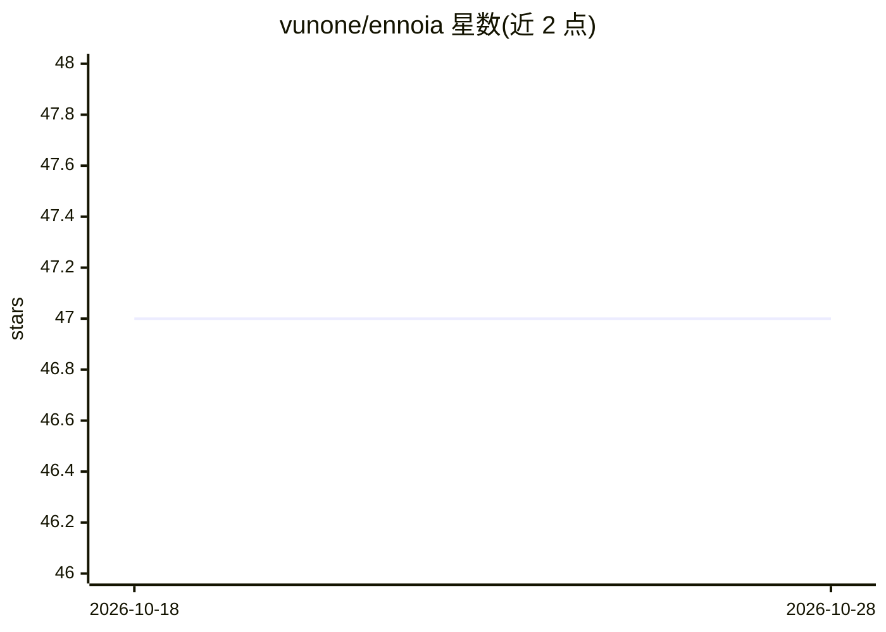

# vunone/ennoia

⭐ 47 · Python · Apache-2.0 · 推送 2026-06-22 · [GitHub](https://github.com/vunone/ennoia) · 个人维护

**声明式文档索引 Python 框架：用类型化 schema 做 LLM 抽取与混合检索**

面向需要结构化文档检索的开发者的 Python 框架：用户以类型化 Python 类（BaseStructure/BaseSemantic/BaseCollection）声明要从每份文档抽取的字段，框架调用 LLM 适配器执行抽取、持久化结构化输出，并在其上提供两阶段检索（结构化过滤先缩小候选集、向量索引再排序）。同一 schema 驱动 SDK、CLI、REST API 与 MCP 工具面。附 ESCI 商品发现基准（与 LangChain 对比）。自称 alpha（0.4.x），API 可能变动；craft 命令生成的 schema 定位为人工编辑起点而非生产产物。

## 筛选速览

| 维度 | 判定 | 备注 |
|---|---|---|
| AI 角色 | `ai-ecosystem` | LLM/agent 周边工具 |
| 许可风险 | `permissive` | Apache-2.0 |
| 部署形态 | `library` | 以包/库形式分发 |
| 模型依赖 | local-ok | 支持本地模型 |
| 硬件要求 | — | 无带数字的原话,不猜 |
| 安装摩擦 | `low` | 无编译、无系统依赖或容器化 |
| 成熟度 | `idea` | |

## 能力要点

- 类型化 Python schema 声明抽取目标，schema 即 diff 中可见的代码
- 两阶段检索：结构化过滤 + 向量排序，支持仅过滤或仅向量
- 同一 schema 驱动 Python SDK、CLI、REST API 与 MCP 工具面
- 可插拔后端：OpenAI/Anthropic/OpenRouter/Ollama LLM 适配器，Qdrant/pgvector/文件系统存储

## 适用场景

- 对含日期、当事方、类别等结构信息的文档语料做混合过滤+向量搜索
- 用 CLI 脚手架生成初版抽取 schema 并迭代验证
- 通过 MCP surface 让 agent 检索已索引文档

## 场景标签

`RAG` · 领域:知识与检索

## 证据(README 行号)

> L11: Ennoia is a Python framework for **Declarative Document Indexing (DDI)** — you describe what to extract from each d
> L81: Ennoia ships a small set of tools for **designing typed schemas, validating them on real documents, and running a f

## 星数曲线

2026-10-18 47 → 2026-10-28 47（+0）

---
*卡片 v1 · prompt 1.4 · 生成 2026-10-25 · 置信度 high · 依据 README sha `41f04dd3ec99` · [字段定义](../../DATASET.md)*
