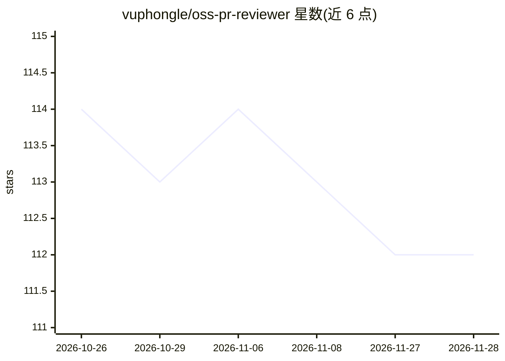

# vuphongle/oss-pr-reviewer

⭐ 112 · TypeScript · MIT · 推送 2026-11-17 · [GitHub](https://github.com/vuphongle/oss-pr-reviewer) · 个人维护

**开源维护者的 AI PR 审查 CLI：检测缺陷并产出报告**

面向开源维护者的命令行工具：抓取 GitHub PR 的元数据与补丁，应用可信 base-commit 规则与忽略列表，将可审查文本分批送入模型，对模型发现做校验与过滤，输出结构化 Markdown/JSON 报告；报告为建议性质，合并决策仍由维护者做出。模型只见元数据与补丁而非整个仓库，不克隆代码、不运行测试；目前仅实现 OpenAI 一家提供方。需 Node.js 20+，从源码检出构建使用，未发布到 npm。

## 筛选速览

| 维度 | 判定 | 备注 |
|---|---|---|
| AI 角色 | `ai-native` | 本体是模型或模型工具 |
| 许可风险 | `permissive` | MIT |
| 部署形态 | `None` |  |
| 模型依赖 | — | README 未给出锁定关系 |
| 硬件要求 | — | 无带数字的原话,不猜 |
| 安装摩擦 | `low` | 无编译、无系统依赖或容器化 |
| 成熟度 | — | 结构信号不足 |

## 能力要点

- 抓取 PR 元数据与补丁，分批送审并校验/过滤模型发现
- 输出结构化 Markdown 或 JSON 报告，严重度不影响退出码
- 提供可选 GitHub Action，可发布受限的任务摘要与评论
- 离线评分器与开发测试无需任何凭据

## 适用场景

- 开源维护者审查社区提交的 pull request
- 在合并前筛查潜在安全风险与缺失测试
- 通过 GitHub Action 在 PR 事件中自动生成审查摘要

## 场景标签

`代码审查` · 领域:编码与开发

## 证据(README 行号)

> L3: Review one GitHub pull request with OpenAI and save an advisory Markdown or JSON report. The CLI fetches PR metadata
> L5: Requires Node.js 20 or newer. The checkout is version 0.4.0; this repository has not published the package to npm. U
> L41: - Only OpenAI is implemented. Automated tests use mocks and do not establish model quality.

## 星数曲线

2026-10-26 114 → 2026-11-28 112（-2）

---
*卡片 v1 · prompt 1.4 · 生成 2026-11-28 · 置信度 high · 依据 README sha `cbfc33f92c8a` · [字段定义](../../DATASET.md)*
