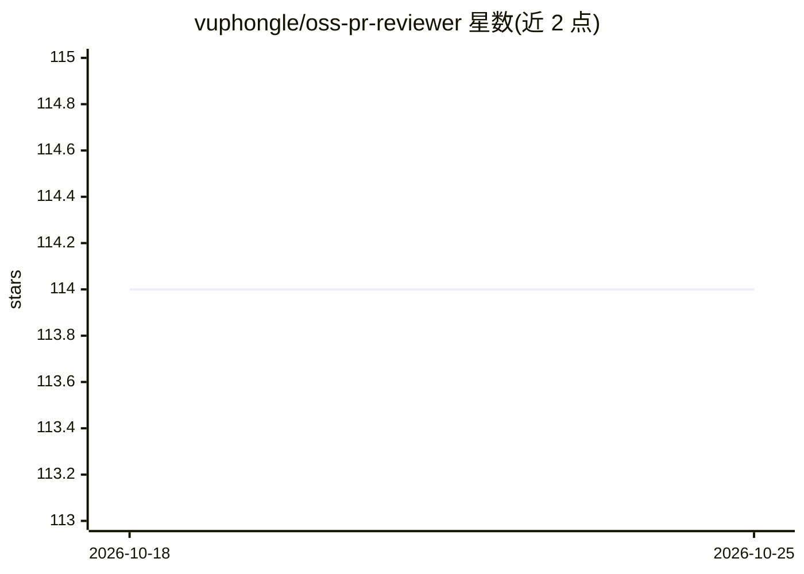

# vuphongle/oss-pr-reviewer

⭐ 114 · TypeScript · MIT · 推送 2026-08-29 · [GitHub](https://github.com/vuphongle/oss-pr-reviewer) · 个人维护

**面向开源维护者的 AI PR 审查 CLI：生成结构化 Markdown 报告**

TypeScript 编写的命令行工具，供开源仓库维护者审查单个 GitHub PR：用 Octokit 拉取 PR 元数据与补丁，切分为确定性批次（每文件 3 万字符、每批 8 文件、4 并发），调用 OpenAI 产出结构化发现，经 Zod 校验、去重与严重度过滤后输出 Markdown 或 JSON 报告，可配合 GitHub Action 发布评论。当前仅支持 OpenAI 一个 provider，v0.4.0 尚未发布到 npm，需从源码 checkout 构建运行。

## 筛选速览

| 维度 | 判定 | 备注 |
|---|---|---|
| AI 角色 | `ai-enhanced` | 去掉 AI 部分产品仍成立 |
| 许可风险 | `permissive` | MIT |
| 部署形态 | `library` | 以包/库形式分发 |
| 模型依赖 | — | README 未给出锁定关系 |
| 硬件要求 | — | 无带数字的原话,不猜 |
| 安装摩擦 | `low` | 无编译、无系统依赖或容器化 |
| 成熟度 | — | 结构信号不足 |

## 能力要点

- PR→批次→OpenAI 分析→校验去重→Markdown/JSON 报告的流水线
- 基于可信基线分支 .oss-pr-reviewer.yml 的仓库级规则与忽略配置
- opt-in GitHub Action：摘要追加与 stale-safe PR 评论
- 429/5xx 指数退避重试与上下文字符预算控制

## 适用场景

- 开源维护者审查 PR 时自动产出发现清单与报告
- CI 中以 JSON 输出集成 AI PR 审查
- 为仓库定制审查规则和忽略路径

## 场景标签

`代码审查` · 领域:编码与开发

## 证据(README 行号)

> L7: `oss-pr-reviewer` assists a maintainer with a focused review of one GitHub pull request. It fetches pull request met
> L136: The CLI depends on a small `ReviewProvider` interface, so the review engine does not contain OpenAI SDK details. T
> L148: - Only OpenAI is implemented as a provider.

## 星数曲线

2026-10-18 114 → 2026-10-25 114（+0）

---
*卡片 v1 · prompt 1.4 · 生成 2026-10-23 · 置信度 high · 依据 README sha `45a6676b8b42` · [字段定义](../../DATASET.md)*
