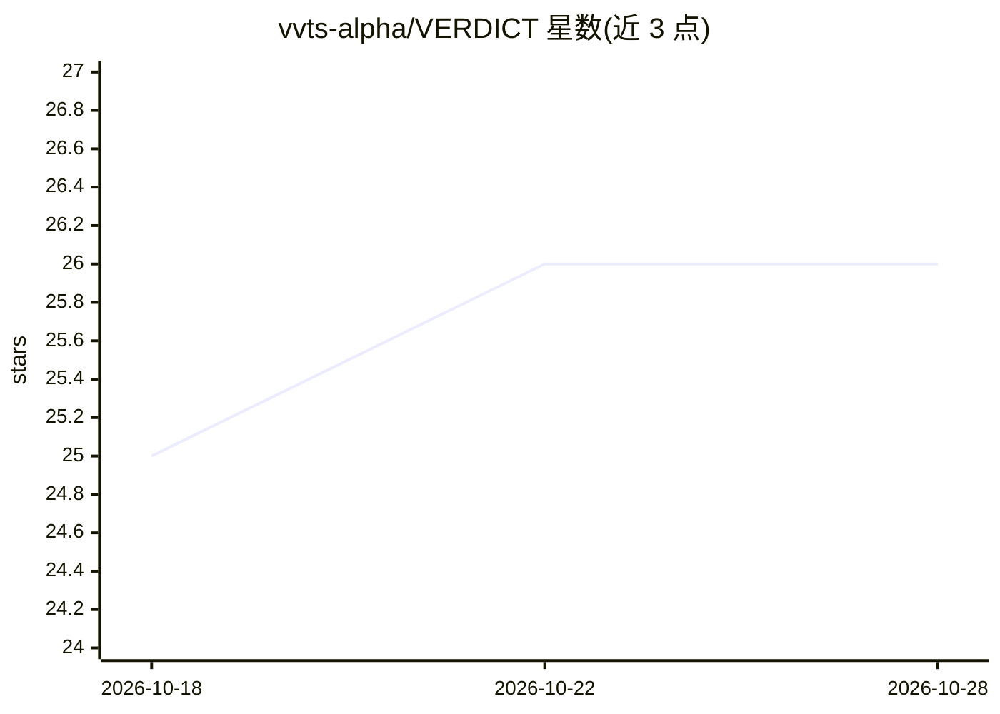

# vvts-alpha/VERDICT

⭐ 26 · TypeScript · 推送 2026-10-26 · [GitHub](https://github.com/vvts-alpha/VERDICT) · 组织维护

**带证据核验的 AI 自动化 Web 渗透测试桌面应用**

面向安全测试人员与 Bug Bounty 参与者的 Windows 桌面应用：以模型引导调查结合确定性探针，对登录后的 Web 应用做注入、访问控制、会话、业务逻辑、秘密泄露与盲回调等检测；每个发现需失败阴性对照与至少两次成功重放确认，附请求/响应与浏览器证据供人工复核。内嵌浏览器处理 SSO/MFA/CAPTCHA 登录并捕获会话；支持 Claude、OpenAI 兼容端点等模型配置，可集成 Burp Suite Professional 主动扫描，导出 HTML/PDF/Markdown 报告。仅授权测试使用，安装包未签名。

## 筛选速览

| 维度 | 判定 | 备注 |
|---|---|---|
| AI 角色 | `ai-native` | 本体是模型或模型工具 |
| 许可风险 | `none` | — |
| 部署形态 | `library` | 以包/库形式分发 |
| 模型依赖 | locked-api |  |
| 硬件要求 | — | 无带数字的原话,不猜 |
| 安装摩擦 | `low` | 无编译、无系统依赖或容器化 |
| 成熟度 | — | 结构信号不足 |

## 能力要点

- 重放式确认：阴性对照失败+两次成功重放才算发现
- 内嵌浏览器完成 SSO/MFA/CAPTCHA 手动登录并捕获会话
- Deep/Light 双模型配置，支持 OpenAI 兼容自定义端点与本地模型服务
- 可接 Burp Suite Professional 串行主动扫描与 Collaborator 回调

## 适用场景

- 对我拥有或获授权的 Web 应用做登录后自动化渗透测试
- Bug Bounty 中核验发现真实性并导出带证据的报告
- 跨账号角色测试访问控制问题

## 场景标签

`网络安全` · 领域:学习与行业

## 证据(README 行号)

> L15: VERDICT combines model-guided investigation with deterministic probes and evidence review. The Windows app includes
> L35: The engine covers injection, access control, sessions, business logic, secret exposure, and blind callbacks. See de

## 星数曲线

2026-10-18 25 → 2026-10-28 26（+1）

---
*卡片 v1 · prompt 1.4 · 生成 2026-10-26 · 置信度 mid · 依据 README sha `d5dbc1617c2f` · [字段定义](../../DATASET.md)*
