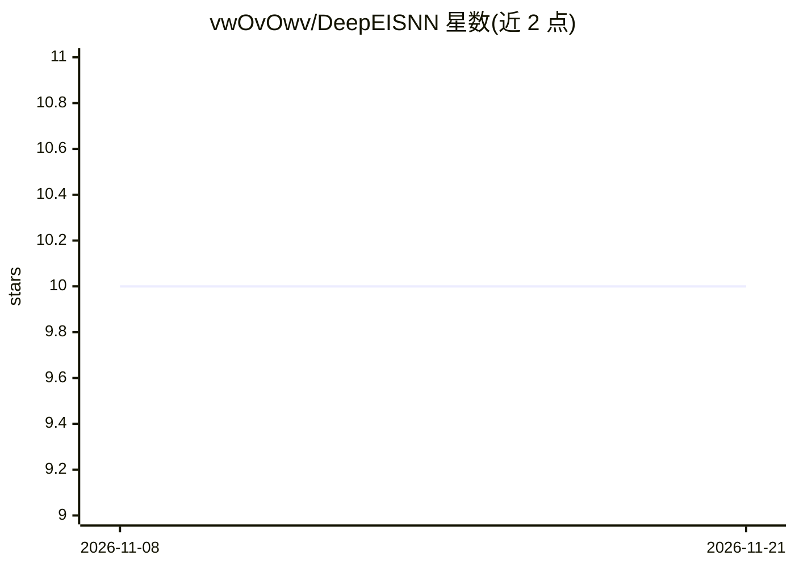

# vwOvOwv/DeepEISNN

⭐ 10 · Python · 推送 2026-05-16 · [GitHub](https://github.com/vwOvOwv/DeepEISNN) · 个人维护

**科研代码库：复现无归一化深层脉冲神经网络论文训练**

ICLR 2026 论文《Training Deep Normalization-Free Spiking Neural Networks with Lateral Inhibition》的官方实现。提供从零训练与断点续训脚本，配置以 YAML 文件组织（EI-SNN 与 BN-SNN 两组实验）；提供 SpikingEiConv2d/SpikingEiLinear 等模块供用户在自己的模型中构建 E-I 结构；支持训练过程参数分布可视化；预训练 checkpoints 托管于 Hugging Face，可通过脚本自动下载并评估，覆盖 CIFAR-10/100、CIFAR10-DVS、DVS-Gesture、TinyImageNet、ImageNet1k 共 11 个模型条目。

## 筛选速览

| 维度 | 判定 | 备注 |
|---|---|---|
| AI 角色 | `ai-native` | 本体是模型或模型工具 |
| 许可风险 | `none` | — |
| 部署形态 | `None` |  |
| 模型依赖 | — | README 未给出锁定关系 |
| 硬件要求 | — | 无带数字的原话,不猜 |
| 安装摩擦 | `medium` | 含编译或系统依赖之一 |
| 成熟度 | — | 结构信号不足 |

## 能力要点

- 提供 SpikingEiConv2d/Linear/Norm 等模块，可嵌入自有模型构建 E-I 结构
- YAML 配置驱动训练，支持从零训练与断点续训
- --log 2 输出训练中各层输入/输出分布可视化
- 预训练 checkpoints 托管 Hugging Face，评估脚本自动下载权重

## 适用场景

- 复现论文中 CIFAR/ImageNet 等数据集上的 SNN 训练结果
- 在自己的网络中接入 E-I 模块做脉冲神经网络研究
- 观察训练过程中参数双峰分布的演化

## 场景标签

`模型训练` · 领域:训练与推理

## 证据(README 行号)

> L6: Code for paper [Training Deep Normalization-Free Spiking Neural Networks with
> L7: Lateral Inhibition](https://openreview.net/forum?id=U8preGvn5G).
> L39: python train.py --scratch configs/EI-SNN/CIFAR10-ResNet18.yaml

## 星数曲线

2026-11-08 10 → 2026-11-21 10（+0）

---
*卡片 v1 · prompt 1.4 · 生成 2026-11-19 · 置信度 high · 依据 README sha `3ff37c1b3c6b` · [字段定义](../../DATASET.md)*
