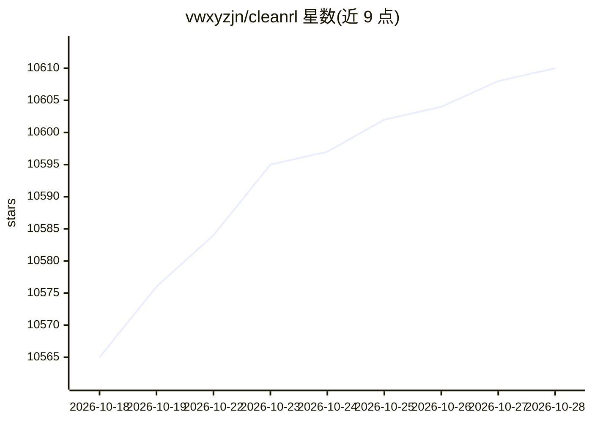

# vwxyzjn/cleanrl

⭐ 10,612 · Python · NOASSERTION · 推送 2026-04-20 · [GitHub](https://github.com/vwxyzjn/cleanrl) · [官网](http://docs.cleanrl.dev) · 组织维护

**深度强化学习算法的单文件实现库，面向研究者**

提供 PPO、DQN、C51、DDPG、TD3、SAC、PPG 等 7+ 种深度强化学习算法的单文件实现，每个算法变体的全部实现细节放在一个独立文件中，便于阅读与调试。非模块化库，不用于被导入。附带基准结果（34+ 游戏）、TensorBoard 日志、种子复现、W&B 实验管理与 AWS/docker 云端集成，并提供 JMLR 论文。安装需 Python 3.7.1–3.10 与 uv。

## 筛选速览

| 维度 | 判定 | 备注 |
|---|---|---|
| AI 角色 | `ai-native` | 本体是模型或模型工具 |
| 许可风险 | `none` | NOASSERTION |
| 部署形态 | `library` | 以包/库形式分发 |
| 模型依赖 | — | README 未给出锁定关系 |
| 硬件要求 | — | 无带数字的原话,不猜 |
| 安装摩擦 | `low` | 无编译、无系统依赖或容器化 |
| 成熟度 | — | 结构信号不足 |

## 能力要点

- 7+ 算法、40+ 变体的单文件实现（含 PyTorch 与 JAX 版本）
- 内置基准（34+ 游戏，benchmark.cleanrl.dev）
- TensorBoard 日志、种子复现、游戏录像捕获
- W&B 实验管理与 AWS/docker 云端批量实验

## 适用场景

- 逐行阅读算法变体的完整实现以理解细节
- 原型验证模块化 DRL 库不支持的高级特性
- 复现并追踪 DRL 实验结果

## 场景标签

`强化学习` · 领域:训练与推理

## 证据(README 行号)

> L11: CleanRL is a Deep Reinforcement Learning library that provides high-quality single-file implementation with researc
> L82: |✅ Proximal Policy Optimization (PPO)|`ppo.py`, docs|

## 星数曲线

2026-10-18 10,565 → 2026-10-28 10,610（+45）

---
*卡片 v1 · prompt 1.4 · 生成 2026-10-20 · 置信度 mid · 依据 README sha `aa50ac54a176` · [字段定义](../../DATASET.md)*
