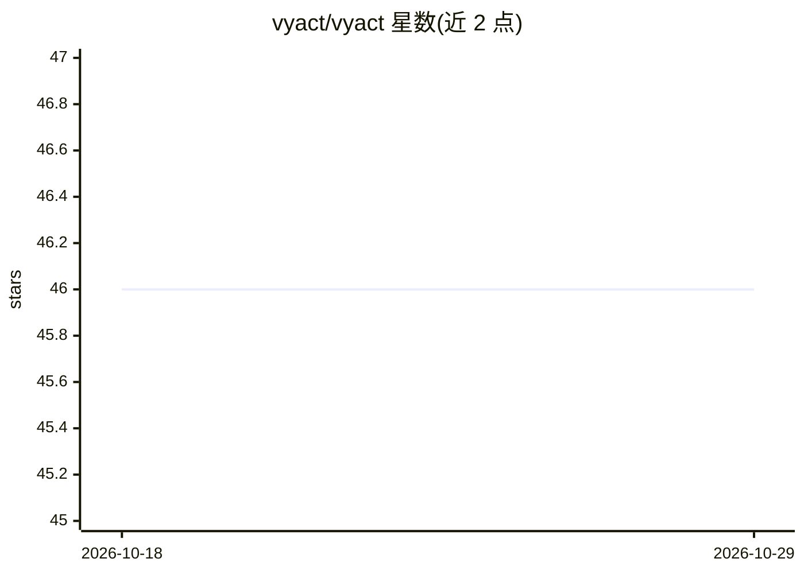

# vyact/vyact

⭐ 46 · Python · AGPL-3.0 · 推送 2026-10-22 · [GitHub](https://github.com/vyact/vyact) · 组织维护

**本地优先的个人 AI 桌面工作台，连接文档/邮件/浏览器**

基于 Electron 的开源桌面应用，面向日常工作的个人用户：本地运行 GGUF 或 Apple Silicon MLX 模型（由应用准备匹配运行时），也可接入云端提供商。功能包括 PDF 文档问答（可打开答案出处核验）、Gmail/Outlook 邮件草稿、代码项目编辑、知识集合、语音对话，以及配套 Chrome 扩展（页面问答、写作检查、翻译、Netflix 双字幕学习）。Google/Microsoft 连接可选且需 OAuth 配置；Intel Mac 不支持。分发形式为 DMG/EXE/AppImage/DEB。

## 筛选速览

| 维度 | 判定 | 备注 |
|---|---|---|
| AI 角色 | `ai-native` | 本体是模型或模型工具 |
| 许可风险 | `viral` | AGPL-3.0 |
| 部署形态 | `desktop` | 安装包/桌面程序 |
| 模型依赖 | local-ok | 支持本地模型 |
| 硬件要求 | — | 无带数字的原话,不猜 |
| 安装摩擦 | `low` | 无编译、无系统依赖或容器化 |
| 成熟度 | — | 结构信号不足 |

## 能力要点

- 本地运行 GGUF 与 Apple Silicon MLX 模型，含内存估算与性能测试
- 文档问答附出处片段可核验，支持知识集合索引
- Chrome 扩展提供页面问答、写作检查、翻译与 Netflix 双字幕学习
- 支持 MCP 工具接入与 OpenAI 兼容本地 API

## 适用场景

- 把本地模型用于 PDF 文档问答与知识检索
- 在 Gmail/Outlook 中生成并插入 AI 回复草稿
- 通过 Chrome 扩展在网页上做写作检查与翻译
- 在本地跑模型并对比不同配置的生成速度

## 场景标签

`文档问答` `AI 助手` · 领域:对话与助手

## 证据(README 行号)

> L9: Vyact brings local AI into your everyday work. Ask questions about your files, reply to email, work on code, and rea
> L25: A 3-minute 29-second tour of local AI for everyday work: model selection and performance testing, document Q&A with
> L140: Compare model size and estimated memory use against your computer before downloading; actual memory use depends on

## 星数曲线

2026-10-18 46 → 2026-10-29 46（+0）

---
*卡片 v1 · prompt 1.4 · 生成 2026-10-25 · 置信度 high · 依据 README sha `41b4a5bcca34` · [字段定义](../../DATASET.md)*
