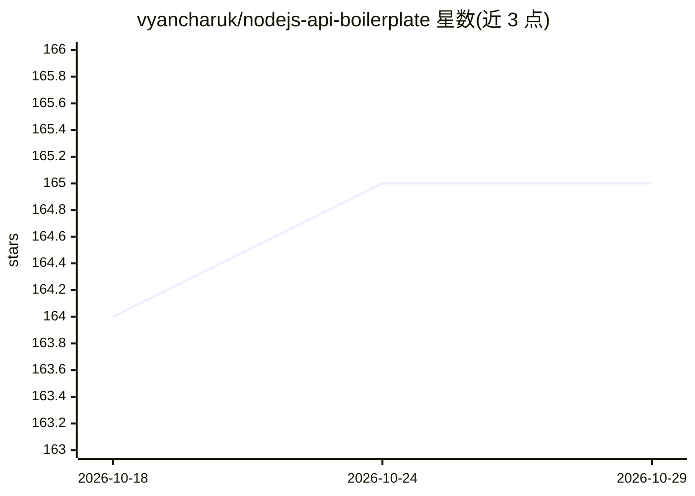

# vyancharuk/nodejs-api-boilerplate

⭐ 165 · TypeScript · MIT · 推送 2026-07-10 · [GitHub](https://github.com/vyancharuk/nodejs-api-boilerplate) · 个人维护

**LLM 生成 CRUD 模块代码的 Node.js/TypeScript API 模板**

两部分组成：一是基于 Node.js、TypeScript、Docker 的 REST API 模板，采用垂直切分架构与 Clean Architecture 原则，集成 Zod 校验、InversifyJS 依赖注入、Redis 缓存、Knex 迁移与 Docker-compose 编排；二是 llm-codegen 代码生成工具，编排 Developer、Troubleshooter、TestsFixer 三个 LLM 微代理，从文本描述生成 CRUD 模块代码、迁移与种子数据，并循环修复编译错误直至 E2E 测试通过。支持 OpenAI、Claude、DeepSeek、OpenRouter/Llama 等提供商 API key。面向 Node.js 后端开发者。

## 筛选速览

| 维度 | 判定 | 备注 |
|---|---|---|
| AI 角色 | `ai-ecosystem` | LLM/agent 周边工具 |
| 许可风险 | `permissive` | MIT |
| 部署形态 | `library` | 以包/库形式分发 |
| 模型依赖 | locked-api |  |
| 硬件要求 | — | 无带数字的原话,不猜 |
| 安装摩擦 | `low` | 无编译、无系统依赖或容器化 |
| 成熟度 | — | 结构信号不足 |

## 能力要点

- 3 个 LLM 微代理（Developer/Troubleshooter/TestsFixer）循环生成并修复 CRUD 模块代码
- 自动生成 DB 迁移、种子数据并通过 E2E 测试验证输出
- 模板采用垂直切分架构、Clean Architecture、Zod 校验与 InversifyJS 依赖注入
- Docker-compose 编排应用、数据库与 Redis，支持本地 SQLite 测试

## 适用场景

- 搭建符合 Clean Architecture 的 Node.js REST API 起步项目
- 用自然语言描述快速生成新的 CRUD 业务模块
- 以 Docker 隔离环境运行 API 与测试

## 场景标签

`代码生成` `编码 Agent` · 领域:编码与开发

## 证据(README 行号)

> L8: An LLM-powered code generation tool that relies on the built-in Node.js API Typescript Template Project to easily ge
> L14: It orchestrates 3 LLM micro-agents (`Developer`, `Troubleshooter` and `TestsFixer`) to generate code, fix compilati

## 星数曲线

2026-10-18 164 → 2026-10-29 165（+1）

---
*卡片 v1 · prompt 1.4 · 生成 2026-10-23 · 置信度 high · 依据 README sha `70973cace601` · [字段定义](../../DATASET.md)*
