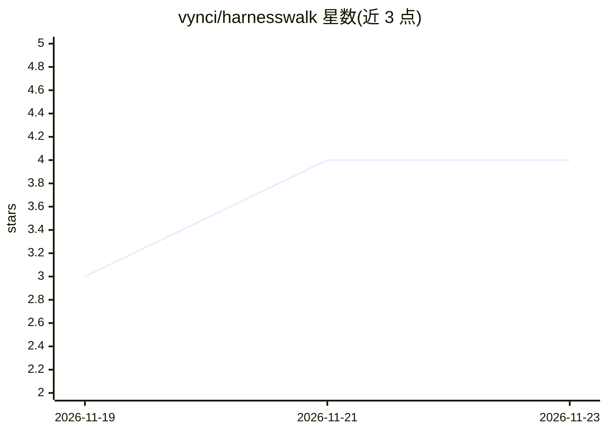

# vynci/harnesswalk

⭐ 4 · Python · Apache-2.0 · 推送 2026-11-17 · [GitHub](https://github.com/vynci/harnesswalk) · [官网](https://harnesswalk.vynci.dev) · 个人维护

**可交互的开源 AI agent harness 参考实现，用于理解与实验**

一个以阅读为目的的教学型 agent harness 参考实现：本地启动一个受治理的聊天 agent，同时在网页图中逐节点高亮请求经过的网关、护栏、审批、上下文构建、记忆、追踪与 eval 门等 29 个节点，可点击查看代码、配置与载荷，支持逐步暂停与重放。自带 10 个合成数据 pack 与 21 章课程，默认用 fake provider 离线运行，也可切换 Anthropic、OpenAI 兼容端点或 Ollama 本地模型。`harnesswalk init` 可生成无运行时依赖的独立 harness 仓库。

## 筛选速览

| 维度 | 判定 | 备注 |
|---|---|---|
| AI 角色 | `ai-ecosystem` | LLM/agent 周边工具 |
| 许可风险 | `permissive` | Apache-2.0 |
| 部署形态 | `library` | 以包/库形式分发 |
| 模型依赖 | local-ok | 支持本地模型 |
| 硬件要求 | — | 无带数字的原话,不猜 |
| 安装摩擦 | `low` | 无编译、无系统依赖或容器化 |
| 成熟度 | `idea` | |

## 能力要点

- 请求逐节点点亮 harness 架构图，可查看每节点的代码、配置、事件与载荷
- 无需模型 key 即可以 fake provider 离线跑通全部流程
- 10 个合成 CC0 数据 pack（PII 脱敏、人工审批、多步工具调用、长会话摘要等演示）
- `harnesswalk init` 生成用户自有的 harness 仓库，无运行时依赖

## 适用场景

- 学习 agent harness 各组件（护栏、审批、eval 门等）的作用与失效后果
- 用自己的文档和工具构建 pack 并在同一个 eval 门下验证
- 在阅读参考实现后，用可视化工具调试自己的真实 agent（配 LangSmith/Langfuse）

## 场景标签

`Agent 框架` `教程课程` · 领域:Agent 开发

## 证据(README 行号)

> L5:  An open-source, interactive reference implementation of an AI agent harness.
> L14: Most agent tutorials show how to call a model, define tools and run a loop. Harnesswalk is about
> L16: memory, the trace, evals and releases. It is an educational, open-source, local-first harness
> L41: - **Not a framework and not a hosted product.** Nothing to build on, nothing to lock into. Copy

## 星数曲线

2026-11-19 3 → 2026-11-23 4（+1）

---
*卡片 v1 · prompt 1.4 · 生成 2026-11-21 · 置信度 mid · 依据 README sha `2f94ccabb55e` · [字段定义](../../DATASET.md)*
