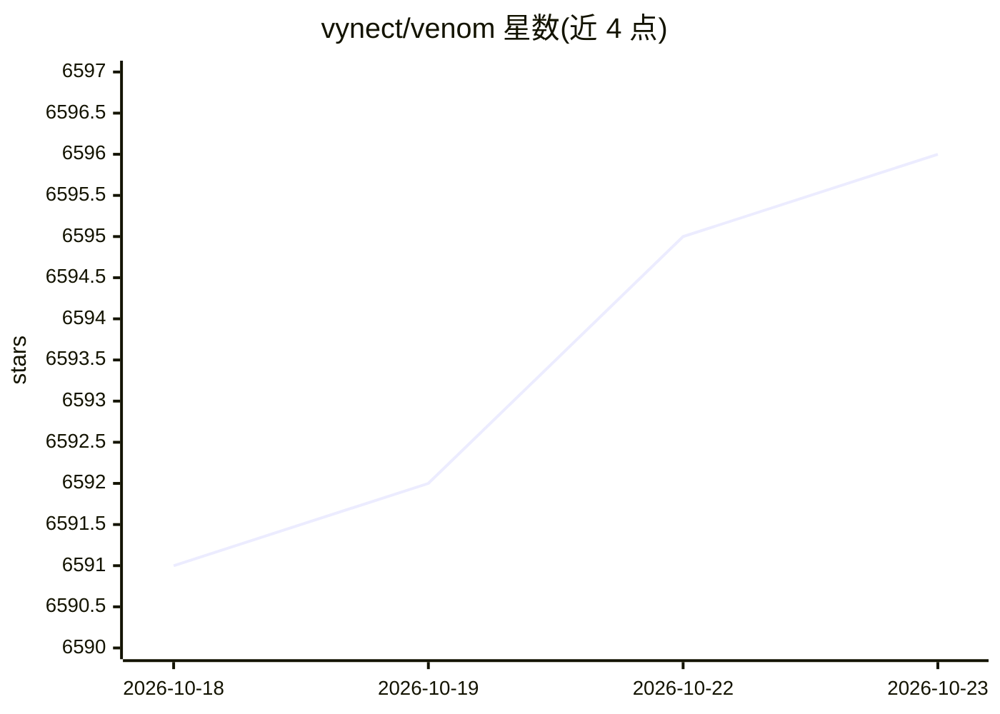

# vynect/venom

⭐ 6,596 · TypeScript · Apache-2.0 · 推送 2026-09-09 · [GitHub](https://github.com/vynect/venom) · [官网](https://orkestral.io) · 组织维护

**JavaScript/TypeScript 开发者的 WhatsApp 自动化库**

基于 Puppeteer 控制 WhatsApp Web 的 Node.js 库（venom-bot，v6 为重写版本）：提供消息发送（文本/图片/视频/文档/贴纸/位置/投票）、聊天与联系人读取、群组管理、资料与设备设置、事件监听、媒体下载、多会话与断线恢复等 API，通过终端二维码登录并自动保存会话。要求 Node.js 18+，Chromium 在安装时自动下载。仓库描述提及基于 AI 的句子识别，但 README 主体为通用自动化能力。

## 筛选速览

| 维度 | 判定 | 备注 |
|---|---|---|
| AI 角色 | `ai-enhanced` | 去掉 AI 部分产品仍成立 |
| 许可风险 | `permissive` | Apache-2.0 |
| 部署形态 | `library` | 以包/库形式分发 |
| 模型依赖 | — | README 未给出锁定关系 |
| 硬件要求 | — | 无带数字的原话,不猜 |
| 安装摩擦 | `low` | 无编译、无系统依赖或容器化 |
| 成熟度 | — | 结构信号不足 |

## 能力要点

- 消息、群组、资料、事件监听等完整 WhatsApp Web API 封装
- 基于纯 Puppeteer，会话自动持久化与多会话支持
- 终端二维码登录，支持指定 WhatsApp Web 版本与断线状态处理

## 适用场景

- 用 JavaScript 构建 WhatsApp 客服或聊天机器人
- 批量收发消息、管理群组与下载媒体
- 读取聊天、联系人与未读消息做数据集成

## 场景标签

`浏览器自动化` · 领域:效率与自动化

## 证据(README 行号)

> L41: npm install venom-bot
> L63: create({ session: 'venom-bot' }).then((client) => {

## 星数曲线

2026-10-18 6,591 → 2026-10-23 6,596（+5）

---
*卡片 v1 · prompt 1.4 · 生成 2026-10-20 · 置信度 mid · 依据 README sha `782c917921cc` · [字段定义](../../DATASET.md)*
