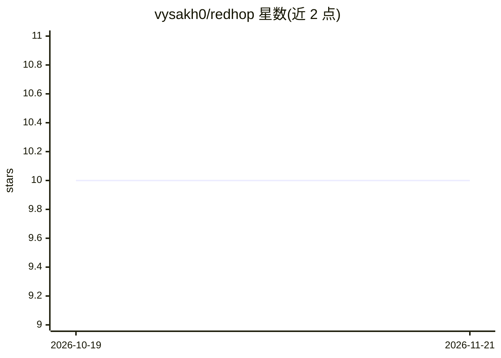

# vysakh0/redhop

⭐ 10 · Rust · Apache-2.0 · 推送 2026-06-15 · [GitHub](https://github.com/vysakh0/redhop) · [官网](https://www.redhopai.com/) · 个人维护

**为 RAG 开发者提供进程内检索与上下文组装运行时**

在文档与 LLM 之间的检索/上下文层：读取文档后执行分块、检索与上下文分配，返回组装好的 prompt 上下文、来源引用及 Decision Report（保留/丢弃内容与原因）。提供 lexical/hybrid/semantic 三级检索、五种组装策略、查询改写工作流，以及无需 LLM 的确定性 CI 评测指标。以 Python（PyPI）、Rust（crates.io）、Node.js（npm）三语言包发布，进程内运行，无向量数据库依赖。

## 筛选速览

| 维度 | 判定 | 备注 |
|---|---|---|
| AI 角色 | `ai-ecosystem` | LLM/agent 周边工具 |
| 许可风险 | `permissive` | Apache-2.0 |
| 部署形态 | `library` | 以包/库形式分发 |
| 模型依赖 | — | README 未给出锁定关系 |
| 硬件要求 | — | 无带数字的原话,不猜 |
| 安装摩擦 | `low` | 无编译、无系统依赖或容器化 |
| 成熟度 | — | 结构信号不足 |

## 能力要点

- 每次调用返回 Decision Report，说明保留、丢弃内容及诊断信息
- 三种检索层级（BM25 默认/hybrid/semantic）与 18 种 Snowball 语言支持
- redhop.evaluate 提供毫秒级确定性词法评测指标，可嵌入 CI
- 诊断接口可指向既有 LangChain/LlamaIndex/pgvector 管线并输出 OpenTelemetry/Langfuse 兼容属性

## 适用场景

- 为合同、工单等模板化查询工作流检测并剥离样板词
- 在 CI 中对检索上下文做确定性 A/B 评测
- 审计已有 LangChain/LlamaIndex 检索管线的上下文质量
- 为多跳问答保留低相关但关键的桥接段落

## 场景标签

`RAG` `LLM 可观测性` · 领域:评测与运维

## 证据(README 行号)

> L56: RedHop is the layer between your documents and the LLM. It is **not** a vector
> L152: **Retrieval tiers.** All tiers run in-process, with no ANN and no index server:

## 星数曲线

2026-10-19 10 → 2026-11-21 10（+0）

---
*卡片 v1 · prompt 1.4 · 生成 2026-11-19 · 置信度 high · 依据 README sha `d5d95af54230` · [字段定义](../../DATASET.md)*
