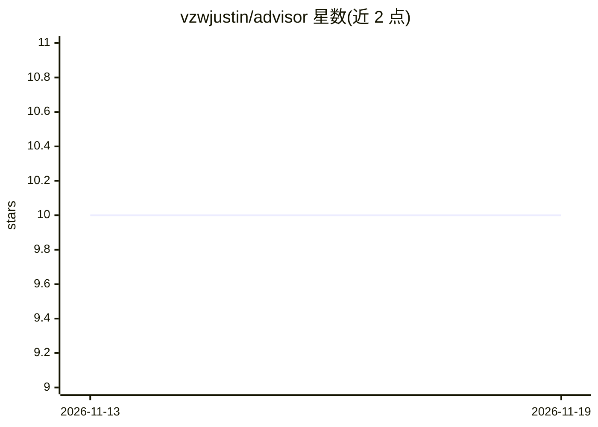

# vzwjustin/advisor

⭐ 10 · Rust · MIT · 推送 2026-07-21 · [GitHub](https://github.com/vzwjustin/advisor) · 个人维护

**给 Claude Code 用户的 Opus 领队代码审查-修复流水线 CLI**

一个 Rust 编写的 CLI 工具（advisor-rs crate），在 Claude Code 内部以 /advisor 斜杠命令运行三级 agent 团队：Opus 做文件发现与 P1–P5 优先级排序并为每个 agent 生成专属提示词，Haiku 探索池做只读结构发现，Sonnet 编码池执行修复；全程经 TeamCreate/Agent/SendMessage 原生工具协调，无外部 API 调用。支持 .advisorignore 排除、SARIF 2.1.0 输出、GitHub Action、实时 dashboard、环境变量与标志配置；Python 包已在 main 分支被 Rust 版取代。

## 筛选速览

| 维度 | 判定 | 备注 |
|---|---|---|
| AI 角色 | `ai-native` | 本体是模型或模型工具 |
| 许可风险 | `permissive` | MIT |
| 部署形态 | `library` | 以包/库形式分发 |
| 模型依赖 | locked-api |  |
| 硬件要求 | — | 无带数字的原话,不猜 |
| 安装摩擦 | `low` | 无编译、无系统依赖或容器化 |
| 成熟度 | — | 结构信号不足 |

## 能力要点

- Opus 领队全程在线调度：重定向偏移、验证产出、按发现调整计划
- 三级团队（Opus 策略 + Haiku 探索池 + Sonnet 编码池），可回退两级模式
- SARIF 2.1.0 输出与可复用 GitHub Action，上传 Code Scanning
- 本地 dashboard（advisor ui）实时查看运行事件流，经 .advisorignore 与优先级阈值控制范围

## 适用场景

- 在 Claude Code 里对当前仓库或指定目录跑多 agent 代码审查
- 以 GitHub Action 定期跑审查并把结果上传到 Code Scanning
- 按 P1–P5 优先级只审查高风险路径（auth/secrets、用户输入等）
- 用终端实时查看 agent 团队的运行事件流

## 场景标签

`多智能体` `代码审查` `编码 Agent` · 领域:Agent 开发

## 证据(README 行号)

> L5: A one-command, Opus-led code review-and-fix pipeline for Claude Code. Opus
> L14: No external API calls. Runs entirely through Claude Code's native

## 星数曲线

2026-11-13 10 → 2026-11-19 10（+0）

---
*卡片 v1 · prompt 1.4 · 生成 2026-11-19 · 置信度 mid · 依据 README sha `0e563d0f3823` · [字段定义](../../DATASET.md)*
