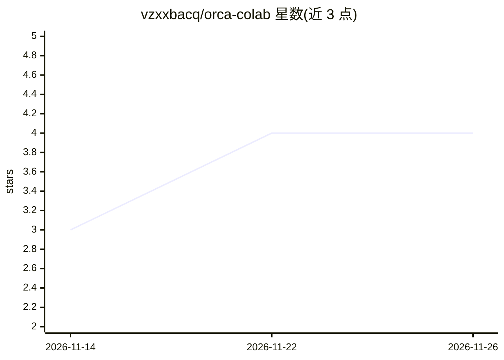

# vzxxbacq/orca-colab

⭐ 4 · JavaScript · MIT · 推送 2026-11-25 · [GitHub](https://github.com/vzxxbacq/orca-colab) · [官网](https://orca.dev/plugins/vzxxbacq/orca-colab) · 个人维护 · 中文 README

**让 Claude Code 等 AI 编码 agent 调用 Google Colab GPU 的插件与 CLI**

一个 Orca 插件兼命令行工具（orca-colab），让 Claude Code、Codex 等 AI 编码 agent 在用户自己的 Google Colab 账户上启动 T4/L4/A100 运行时，同步工作区、提交训练/微调/推理任务、回拉检查点与指标，并释放运行时。通过 JSON CLI 与 `colab-gpu` agent 技能驱动，Orca 面板实时展示输出与算力消耗；人类通过 Guardrails 限定可用 GPU 档位、并发数与月度 Compute Unit 预算。全部走 HTTPS，无需 VPN/SSH。MIT 许可，社区项目，非 Google 官方。

## 筛选速览

| 维度 | 判定 | 备注 |
|---|---|---|
| AI 角色 | `ai-ecosystem` | LLM/agent 周边工具 |
| 许可风险 | `permissive` | MIT |
| 部署形态 | `library` | 以包/库形式分发 |
| 模型依赖 | — | README 未给出锁定关系 |
| 硬件要求 | — | 无带数字的原话,不猜 |
| 安装摩擦 | `low` | 无编译、无系统依赖或容器化 |
| 成熟度 | — | 结构信号不足 |

## 能力要点

- agent 通过单一 JSON CLI 自主完成 up/sync/job submit/pull/down 全流程
- 人类设置 guardrails：GPU 档位白名单、并发上限与月度 CU 预算
- 结果二进制安全回拉，运行时自身代理通道，不开端口、不需 VPN/SSH
- 支持多 GPU 并行、多 Google 账户切换与远程 Orca 服务器（Beta）

## 适用场景

- 让编码 agent 在云端 GPU 上跑训练或微调任务
- 笔记本无 GPU 时给 agent 提供临时算力并回拉结果
- 复用已有 Colab 订阅的算力额度做交互式实验与评测

## 场景标签

`编码 Agent` `微调` `模型评测` · 领域:编码与开发

## 证据(README 行号)

> L7: **Colab GPU for Orca** (`orca-colab`) is an Orca plugin and command-line tool that lets Claude Code, Codex and other
> L22: - **Agents manage compute**: the agent checks your policy, provisions or scales parallel runtimes, syncs the
> L23:  workspace, installs dependencies, runs jobs and releases idle GPUs, all through one JSON CLI.

## 星数曲线

2026-11-14 3 → 2026-11-26 4（+1）

---
*卡片 v1 · prompt 1.4 · 生成 2026-11-21 · 置信度 high · 依据 README sha `79b8ba9e5666` · [字段定义](../../DATASET.md)*
