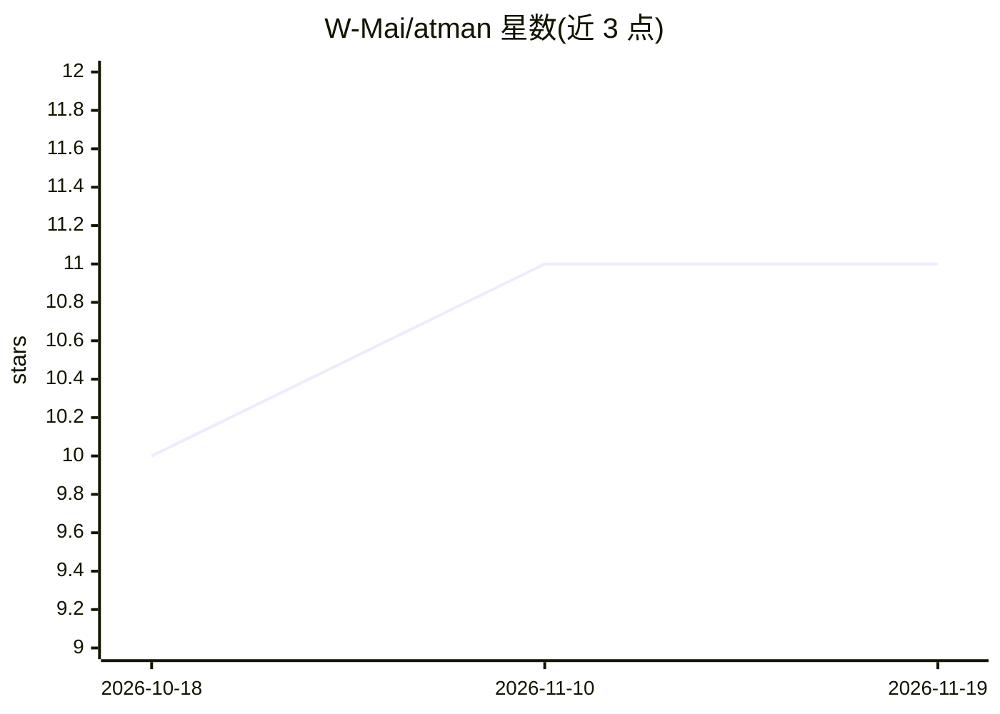

# W-Mai/atman

⭐ 11 · Rust · Apache-2.0 · 推送 2026-11-18 · [GitHub](https://github.com/W-Mai/atman) · [官网](https://atman.run) · 个人维护

**为开发者提供流驱动的 AI 编码 Agent 运行时与 .at 工作流 DSL**

atman 是一个以 Rust 编写的终端 TUI 应用与运行时，用户用 .at DSL 编写编码 agent 工作流，将 LLM 调用、工具、审批与子 agent 编排为可复现的流；每次运行产生可回放、审计与监控的类型化事件轨迹。提供持久化 Session/Flow 实例、浮动窗口、快速提问、项目会话管理、历史恢复与分支等 TUI 功能，并通过 daemon 与回环 RPC 支持后台执行与跨主机会话转移。API key 经环境变量或 config.toml 配置。

## 筛选速览

| 维度 | 判定 | 备注 |
|---|---|---|
| AI 角色 | `ai-ecosystem` | LLM/agent 周边工具 |
| 许可风险 | `permissive` | Apache-2.0 |
| 部署形态 | `desktop` | 安装包/桌面程序 |
| 模型依赖 | — | README 未给出锁定关系 |
| 硬件要求 | — | 无带数字的原话,不猜 |
| 安装摩擦 | `low` | 无编译、无系统依赖或容器化 |
| 成熟度 | — | 结构信号不足 |

## 能力要点

- .at DSL 编排 LLM 调用、工具、审批与子 agent，Turing-complete
- 每次运行生成可回放与审计的类型化事件轨迹
- macOS/Linux/Windows 一行 shell 安装，支持 Homebrew 与 Cargo 安装
- 持久化 Session/Flow、分支保留、历史索引恢复与 daemon 后台执行

## 适用场景

- 用确定性工作流替代单一聊天式 agent 决策
- 需要回放与审计每次 agent 运行轨迹的团队
- 在终端中管理多项目多会话的编码 agent 任务
- 在 daemon 上后台运行并跨主机转移会话

## 场景标签

`编码 Agent` · 领域:编码与开发

## 证据(README 行号)

> L47: `atman` turns coding-agent workflows into reproducible flows written in the `.at` language — atman's own DSL for wi
> L49: The managed agent template lives at `examples/agent.at`. It demonstrates a bounded recursive loop around `llm.call`

## 星数曲线

2026-10-18 10 → 2026-11-19 11（+1）

---
*卡片 v1 · prompt 1.4 · 生成 2026-11-18 · 置信度 high · 依据 README sha `581e410d451e` · [字段定义](../../DATASET.md)*
