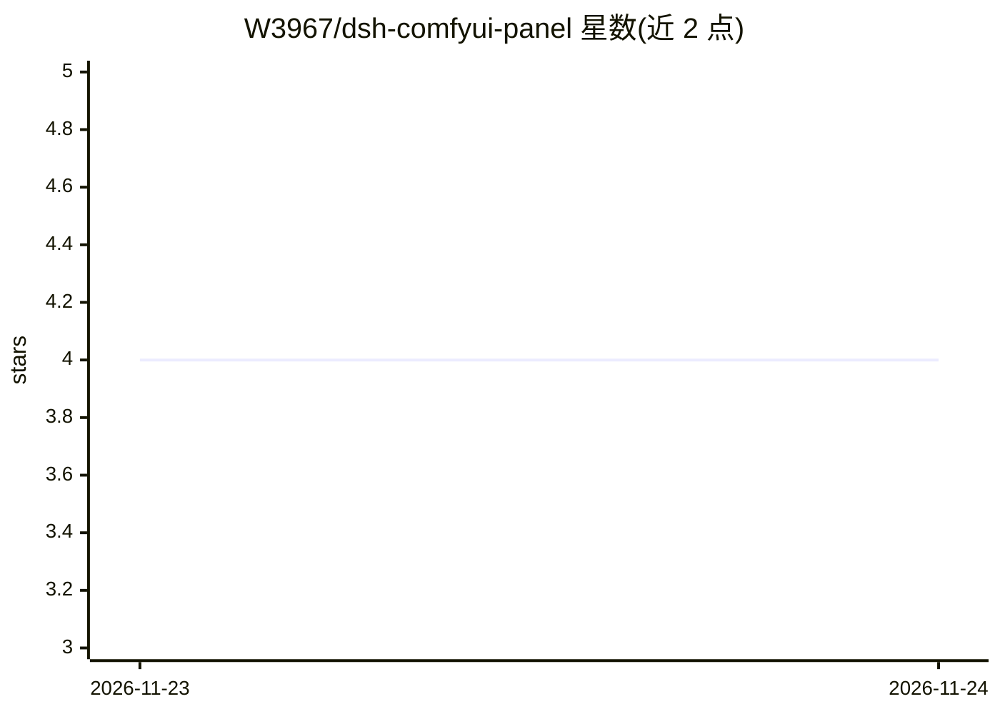

# W3967/dsh-comfyui-panel

⭐ — · [GitHub]() · 个人维护 · 中文 README

**给 DSH 用户接入本机 ComfyUI：导入工作流自动生成参数表单出图**

一个 DeepSeek Harness（DSH）插件，把本机 ComfyUI 接进 DSH 侧栏：导入 API 格式导出的工作流 JSON 后，基于 ComfyUI 的 /object_info 元数据、连线关系与语义规则表做参数发现，自动生成含正负提示词、种子、步数、模型、LoRA 等控件的表单。面板与模型 agent 工具共用同一任务队列，支持队列管理、历史图片浏览与参数恢复、参数预设、ComfyUI 启停。前置要求本机 ComfyUI 在跑；只解析 API 格式工作流，单次生成上限 10 分钟，启动/关闭仅对本机便携版 ComfyUI 有效。

## 筛选速览

| 维度 | 判定 | 备注 |
|---|---|---|
| AI 角色 | `ai-enhanced` | 去掉 AI 部分产品仍成立 |
| 许可风险 | `permissive` | — |
| 部署形态 | `desktop` | 安装包/桌面程序 |
| 模型依赖 | locked-api |  |
| 硬件要求 | `gpu-8g` | |
| 安装摩擦 | `low` | 无编译、无系统依赖或容器化 |
| 成熟度 | — | 结构信号不足 |

## 能力要点

- 导入任意 API 格式工作流 JSON，自动生成参数表单
- 注册两个 agent 工具（krea2_workflows / krea2_generate）供模型调用生成
- 队列、历史图片（含 PNG 元数据恢复参数）与参数预设管理
- 内置 Krea 2 文生图 / 风格参考预设

## 适用场景

- 在 DSH 侧栏里不切浏览器直接用 ComfyUI 出图
- 把 ComfyUI 里搭好的工作流变成带表单的预设
- 让模型通过 agent 工具按参数提交生成任务

## 场景标签

`图像生成` · 领域:内容生成

## 证据(README 行号)

> L7: 把本机 **ComfyUI** 接进 DeepSeek Harness：导入任意 API 格式工作流，自动生成参数表单，侧栏里直接出图。
> L32: - **两种输入**：面板点着用，或者让模型通过 agent 工具调用，两者共用同一条任务队列。
> L43: 1. **ComfyUI** 在跑（默认 `http://127.0.0.1:8188`），版本建议 ≥ 0.26.0。

## 星数曲线

2026-11-23 4 → 2026-11-24 4（+0）

---
*卡片 v1 · prompt 1.4 · 生成 2026-11-23 · 置信度 high · 依据 README sha `23885b6f1932` · [字段定义](../../DATASET.md)*
