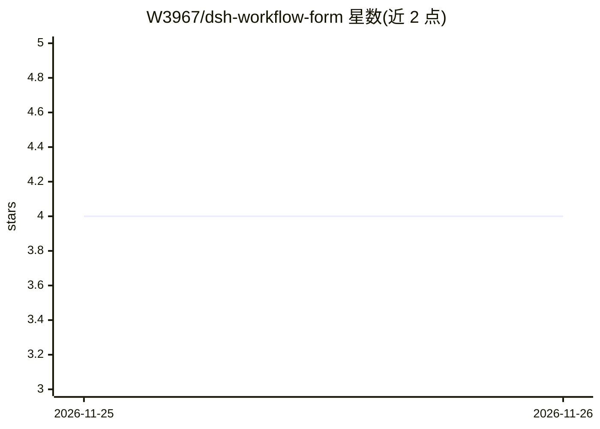

# W3967/dsh-workflow-form

⭐ 4 · JavaScript · MIT · 推送 2026-11-25 · [GitHub](https://github.com/W3967/dsh-workflow-form) · [官网](https://github.com/W3967/dsh-comfyui-panel) · 个人维护 · 中文 README

**把 ComfyUI 接入 DSH 的插件：工作流自动生成参数表单**

DeepSeek Harness 的 ComfyUI 前端插件：导入 ComfyUI「Save (API Format)」导出的 JSON，基于 /object_info 元数据与语义规则表自动生成参数表单，面板内提交生成、轮询进度、浏览历史图片并恢复参数。另注册两个 agent 工具供模型调用，与面板共用同一任务队列与校验。依赖本机已运行的 ComfyUI；只解析 API 格式工作流，复杂图会退化为通用控件；启动/关闭仅在本机便携版有效。

## 筛选速览

| 维度 | 判定 | 备注 |
|---|---|---|
| AI 角色 | `ai-native` | 本体是模型或模型工具 |
| 许可风险 | `permissive` | MIT |
| 部署形态 | `desktop` | 安装包/桌面程序 |
| 模型依赖 | locked-api |  |
| 硬件要求 | `gpu-8g` | |
| 安装摩擦 | `low` | 无编译、无系统依赖或容器化 |
| 成熟度 | — | 结构信号不足 |

## 能力要点

- 基于 /object_info 的参数发现：任意工作流自动生成表单，未知节点退化为通用控件
- 内置 Krea 2 文生图与风格参考预设，8 GB 显存可跑
- 面板与 agent 工具双入口，共用任务队列与校验，串行执行避免抢显存
- 历史图片支持恢复参数、从 PNG 元数据还原设置

## 适用场景

- 在 DSH 侧栏里直接用 ComfyUI 工作流出图，不切浏览器
- 把常用参数存成预设，下次一键套用
- 让模型通过 agent 工具提交生成任务并拿到图片路径

## 场景标签

`图像生成` · 领域:内容生成

## 证据(README 行号)

> L7: 把本机 **ComfyUI** 接进 DeepSeek Harness：导入任意 API 格式工作流，自动生成参数表单，侧栏里直接出图。
> L17: 插件的核心不是某一套模型，而是**参数发现**：拿 ComfyUI 自己的 `/object_info` 当元数据，把任意工作流图翻译成表单。
> L32: - **两种输入**：面板点着用，或者让模型通过 agent 工具调用，两者共用同一条任务队列。

## 星数曲线

2026-11-25 4 → 2026-11-26 4（+0）

---
*卡片 v1 · prompt 1.4 · 生成 2026-11-24 · 置信度 high · 依据 README sha `559e1724dcad` · [字段定义](../../DATASET.md)*
