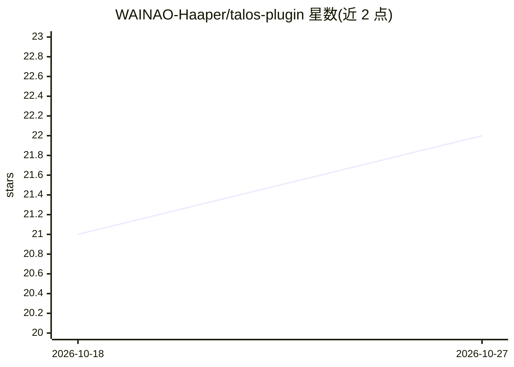

# WAINAO-Haaper/talos-plugin

⭐ 22 · TypeScript · NOASSERTION · 推送 2026-10-13 · [GitHub](https://github.com/WAINAO-Haaper/talos-plugin) · 个人维护 · 中文 README

**把 Obsidian Vault 变为可治理的个人 AI 工作台插件**

Obsidian 原生桌面插件，将 Vault 内任务、项目、知识、收件箱、健康记录与发布状态汇总为实时控制台，并提供多智能体对话工作台（Claude/Codex/OhMyPi/本机登录态/兼容 Anthropic/OpenAI 协议的 Direct API）、嵌入式 DeepSeek Harness，以及基于 Qwen Realtime 的「屈原」实时语音（转写、语音回复、语音只读工具）。执行经 OS 沙箱与审批策略约束，Windows 当前为 Plan-only。通过 Releases ZIP 手动安装，macOS 为主要平台。

## 筛选速览

| 维度 | 判定 | 备注 |
|---|---|---|
| AI 角色 | `ai-native` | 本体是模型或模型工具 |
| 许可风险 | `none` | NOASSERTION |
| 部署形态 | `library` | 以包/库形式分发 |
| 模型依赖 | locked-api |  |
| 硬件要求 | — | 无带数字的原话,不猜 |
| 安装摩擦 | `low` | 无编译、无系统依赖或容器化 |
| 成熟度 | `idea` | |

## 能力要点

- 多智能体工作台支持会话恢复、分叉、MCP、工具调用与子智能体
- 屈原 Qwen Realtime 实时语音：唤醒、连续对话、转写、语音回复，语音工具默认只读
- 安全机制：API 密钥仅存 SecretStorage，无沙箱时 Execute 失败关闭
- 全库视图与收件箱治理：内容分布、README 完整性、积压聚类

## 适用场景

- 在 Obsidian 内统一查看与管理整个 Vault 的任务、知识与发布状态
- 在控制台内进行多智能体对话并经审批执行操作
- 用语音查询 Vault 状态、统计与进度

## 场景标签

`多智能体` `语音 Agent` `知识库管理` · 领域:Agent 开发

## 证据(README 行号)

> L10: TALOS 是一个桌面端 Obsidian 原生插件。它把散落在 Vault 里的任务、项目、知识、收件箱、健康记录和发布状态汇总为一个实时控制台，并把多智能体对话、审批治理和「屈原」实时语音放进同一套工作流。
> L41: - **多智能体工作台**：支持 Claude、Codex、OhMyPi、本机登录态和兼容 Anthropic/OpenAI 协议的 Direct API Provider；提供会话恢复、分叉、压缩、附件、工具调用、diff、MC
> L43: - **屈原 Qwen Realtime 语音**：支持语音唤醒、持续监听、实时转写、音频回复、文本只读查询和 TALOS Ball 状态舞台。

## 星数曲线

2026-10-18 21 → 2026-10-27 22（+1）

---
*卡片 v1 · prompt 1.4 · 生成 2026-10-27 · 置信度 high · 依据 README sha `e08a2d53f644` · [字段定义](../../DATASET.md)*
